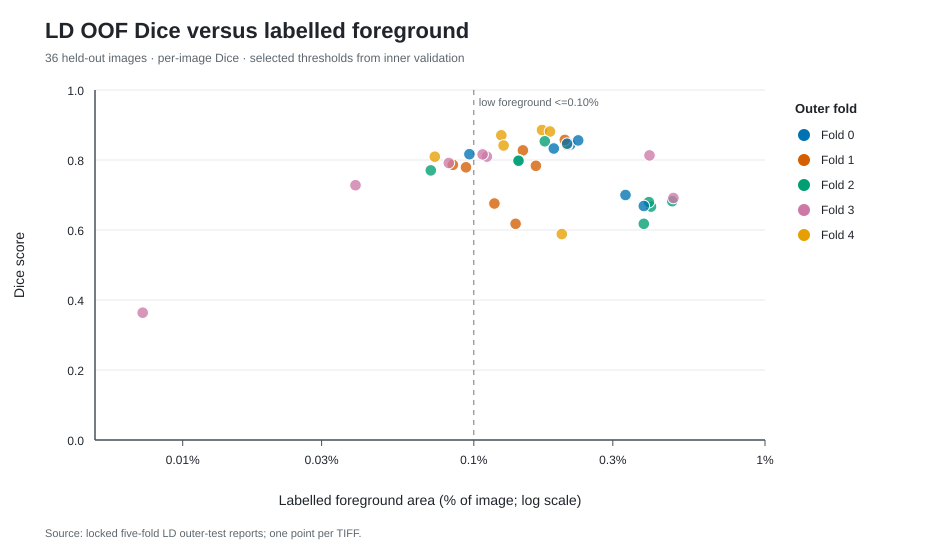
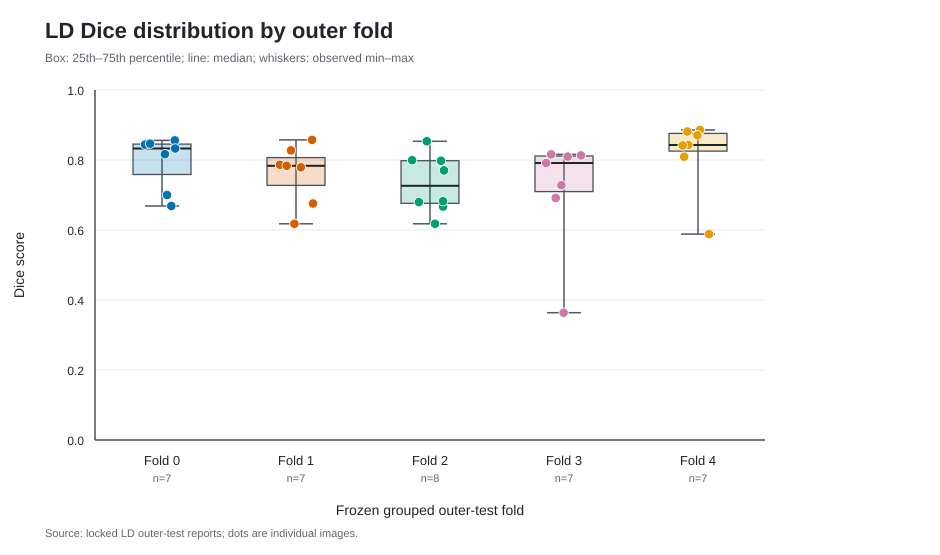
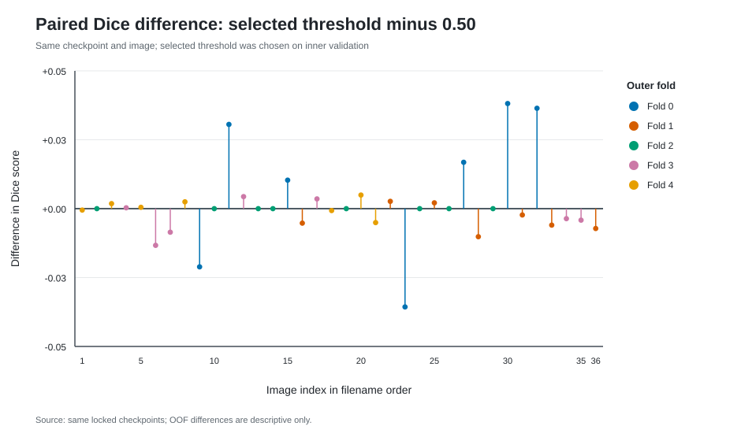

# LD 2D U-Net five-fold baseline

Generated 2026-10-12 from the completed, locked five-fold LD
evaluation. This document is **reporting only**: no candidate model, checkpoint,
mask-conversion rule, or prediction threshold was selected using the scores below.

## Data and locked protocol

All 36 same-name LD image and manual-mask TIFF pairs are labelled development
data, not independent external test cases. Source masks are preserved. The
[pretraining label rule](../../experiments/ld_antialias_label_protocol.md)
converts Photoshop-antialiased masks at 50% of each file's observed maximum
to a separate `uint8` 0/1 mask. Relative to a nonzero rule, the midpoint
excludes 5,125 faint pixels, mostly along boundaries; eight faint connected
regions containing 12 pixels disappear entirely and remain a biological
annotation-review uncertainty. It was fixed before training and never changed
in response to model performance.

The [frozen five-fold protocol](../../experiments/ld_five_fold_baseline_protocol.md)
groups input-only suspected near-duplicates before splitting. Fold sizes are
7, 7, 8, 7, 7. For each outer fold, the next fold is inner validation and the
remaining three folds are training. The LD model starts from random weights:
2D U-Net with four pooling stages, base width 32, 512×512 crops in original
coordinates, BCE + soft-Dice, 0.6 positive-centered crop probability, batch
size 4, Adam learning rate 1e-4, 100 steps/epoch and at most 100 epochs.
Full-resolution 512-pixel overlapping-window validation chooses the checkpoint
at fixed 0.50. Only inner validation selects its deployment threshold. Each
outer-test label is opened after the fold's selection lock is written.

The five-fold reporter rechecked 36 distinct held-out filenames, unchanged
splits and scientific settings, source-code snapshots, checkpoint and threshold
hashes, and saved validation artifacts before producing these figures. Its
sample standard deviation uses `ddof=1` across images. Derived-label manifest
SHA256: `2c026147620ae6ebfe016287f6607b1ae3b9674cd77dc71160682b9acbec9879`. Fold-map SHA256:
`696fd11435a292d877406b7437c8bd9760ef720530358f5cdc5b77c976e3abd6`. Canonical frozen-source hash-list SHA256:
`9e3dde91eeda880c936630ff77e230a9a73ecdafca07ecb4c0cc849730685234`. Small verified metric files are included beside this report;
TIFFs, predictions, and model weights remain outside Git.

## Out-of-fold results

Each image contributes exactly one outer held-out score. The primary reported
policy uses the threshold selected by that fold's inner validation.

| Metric | Mean ± sample SD | Median | Minimum | Maximum |
| --- | ---: | ---: | ---: | ---: |
| Dice | 0.7637 ± 0.1070 | 0.7985 | 0.3636 | 0.8858 |
| Iou | 0.6283 ± 0.1264 | 0.6645 | 0.2222 | 0.7950 |
| Precision | 0.7619 ± 0.0949 | 0.7693 | 0.3871 | 0.9122 |
| Recall | 0.7829 ± 0.1594 | 0.8482 | 0.3429 | 0.9491 |

The same checkpoints evaluated at fixed threshold 0.50 provide an offline
policy comparison; this comparison **must not** be used to pick whichever
policy looks best on outer-test data.

| Metric | Mean ± sample SD | Median | Minimum | Maximum |
| --- | ---: | ---: | ---: | ---: |
| Dice | 0.7628 ± 0.1032 | 0.7961 | 0.3770 | 0.8863 |
| Iou | 0.6264 ± 0.1218 | 0.6613 | 0.2323 | 0.7959 |
| Precision | 0.7546 ± 0.0912 | 0.7539 | 0.4186 | 0.9170 |
| Recall | 0.7899 ± 0.1599 | 0.8450 | 0.3429 | 0.9565 |

The mean paired Dice difference (validation-selected minus fixed 0.50) is
+0.0009; 14 images improve,
14 worsen, and 8 tie. These are
descriptive outer-test observations, not a selection rule.

### Fold-level results

| Fold | Held-out images | Validation-selected threshold | Mean Dice | Median Dice | Min Dice | Mean IoU | Mean precision | Mean recall |
| ---: | ---: | ---: | ---: | ---: | ---: | ---: | ---: | ---: |
| 0 | 7 | 0.90 | 0.7950 | 0.8329 | 0.6687 | 0.6653 | 0.7978 | 0.8045 |
| 1 | 7 | 0.25 | 0.7611 | 0.7834 | 0.6177 | 0.6205 | 0.7162 | 0.8278 |
| 2 | 8 | 0.50 | 0.7334 | 0.7262 | 0.6177 | 0.5849 | 0.7686 | 0.7263 |
| 3 | 7 | 0.30 | 0.7162 | 0.7916 | 0.3636 | 0.5761 | 0.6849 | 0.7581 |
| 4 | 7 | 0.35 | 0.8171 | 0.8428 | 0.5884 | 0.7007 | 0.8411 | 0.8057 |

### Sparse-label and worst-case audit

Using a fixed descriptive cutoff of at most 0.10% labelled foreground,
the low-foreground subset has 8 images and mean Dice 0.7306; the
remaining 28 images have mean Dice 0.7731. These summaries are
descriptive and should not define a new model-selection gate after viewing
outer-test results. The five lowest Dice images are `ld_006.tif` (0.3636), `ld_020.tif` (0.5884), `ld_014.tif` (0.6177), `ld_022.tif` (0.6177), `ld_002.tif` (0.6667). Inspecting
them may reveal hypotheses, but targeted tuning to these same held-out images
would invalidate an unbiased comparison on this 36-image pool.

Pixel-overlap metrics do not by themselves establish droplet-level recall,
boundary accuracy, or annotation consistency. Eight-connected regions no
larger than 25 pixels may be analysed as **semantic component proxies**, never
as verified individual droplets. False-positive distance, false-negative
depth, component-scale detection and representative input/GT/probability
overlays require the separate validation-only diagnostic; no such mechanism
is inferred from these aggregate scores.

## Interpretation and limitations

This result estimates image-level performance within 36 heterogeneous,
manually labelled development images. Similar-input groups were kept intact,
but specimen identity and Z order cannot be recovered, so additional related
views may cross folds. No independently labelled external LD images are
available; prospective generalization is unknown. The antialias midpoint is
an operational annotation convention, not proof that gray edge pixels are
biologically negative. Precision/recall changes must be interpreted alongside
this label uncertainty.

The full OOF and all-fold validation aggregates must not be used to choose
architectures, sampling, loss, threshold or postprocessing and then claim an
untouched comparison on these same outer folds. Because rotated validation
places each image in one fold's validation set and another fold's outer test,
even an all-fold validation error aggregate can indirectly expose every
image. A later single-factor candidate needs a predeclared hypothesis and
fold-local training/validation-only selection before outer evaluation; any
selection using repeated OOF comparisons is exploratory and needs independent
confirmation.

## Reproducibility

- Baseline protocol frozen in private Git commit `6e3727b` before LD GPU work.
- `oof_per_image.csv` and `oof_summary.json` beside this report are exact
  copies of the independently verified five-fold CV outputs.
- Figures are static, self-labelled SVGs generated from those OOF metrics;
  they contain no image pixels or model predictions.
- The GPU run, full checkpoints, TIFF probabilities/masks and logs are kept
  in the local ignored result archive. RunPod costs and cleanup are recorded
  separately from model metrics and cannot be inferred from this report.
