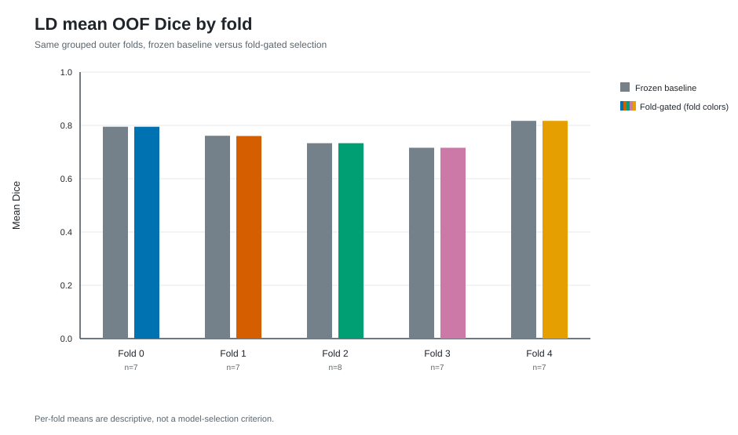
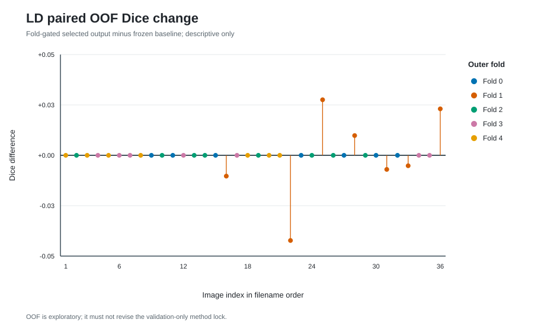
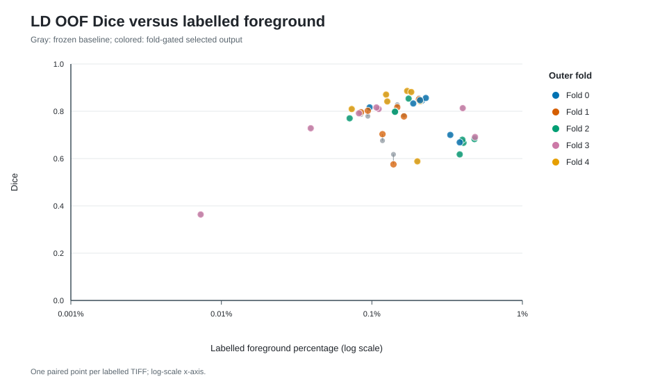
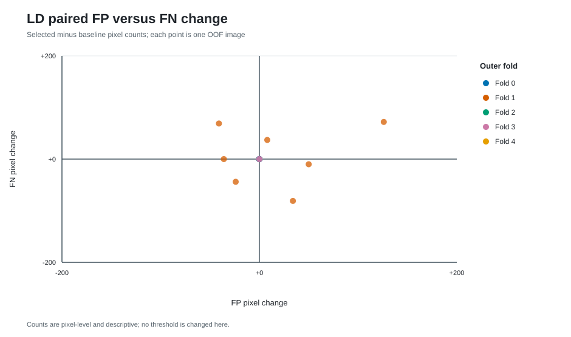

# LD 连通域均匀采样：五折验证门控与 OOF 误差审计

**结论（2026-10-12）：保留冻结的 LD 基线作为生产方法。** 预先规定的逐折验证门控只在五折中的第 1 折选中连通域均匀采样候选；另行预先规定的全局生产方法规则要求至少四折胜出、36 次内层验证的平均 Dice 增益至少 +0.01，并要求各折精确率守住安全界限。这三项中前两项失败，精确率界限也在第 2 折失败。[全局方法锁](../../experiments/results/ld_method_policy.lock.json)因此选择基线，不能用下文的 OOF 分数改写这一决定。逐折门控后的 36 图 OOF 平均 Dice 为 **0.763570 ± 0.108188**，冻结基线为 **0.763693 ± 0.106970**；逐图配对平均变化 **−0.000123**。这里的“±”是图像间样本标准差（`ddof=1`）。这些是同一开发数据集上的探索性内部证据，不是独立外部验证，也不是一个已训练好的全 36 图单模型的性能。

## 设计、数据与事先锁定的选择规则

36 对同名 LD 输入／人工 mask TIFF 均属已标注开发数据。原始 mask 未改动；[预训练标签规则](../../experiments/ld_antialias_label_protocol.md)先按每个文件所见最大值的 50% 将抗锯齿 mask 转为独立的 0/1 标签。输入图像审计在**不读标签**的条件下将疑似近重复图像成组，再由[冻结五折协议](../../experiments/ld_five_fold_baseline_protocol.md)固定折图：外层测试折大小为 7、7、8、7、7；每折的下一折作内层验证，其余三折训练。分组只能降低已发现的相关视图跨折风险，不能恢复标本身份或 Z 顺序。

基线是随机初始化的单通道 2D U-Net（基础宽度 32、四层下采样），在原始 1200×1200 图像上抽取 512×512 patch；正样本中心分支概率为 0.60，均匀裁剪分支为 0.40。使用 BCE + soft-Dice、Adam `1e-4`、batch 4、每 epoch 100 step、最多 100 epoch。完整图像验证在固定阈值 0.50 选择 checkpoint；选定 checkpoint 后，只用该折内层验证图像在 0.10–0.90、步长 0.05 的网格上选部署阈值。外层测试标签只供锁定后评价。[基线报告](../ld_baseline_5fold_20261012/README.md)保留了其独立 OOF 结果。

[候选协议](../../experiments/ld_component_uniform_sampling_protocol.md)只改变 0.60 正样本中心分支：在已抽中的**训练图像**里先均匀抽取一个非空的八连通语义 mask 组件，再均匀抽取其中一个前景像素为裁剪中心。0.40 均匀分支、图像抽样、模型、损失、增强、训练和验证规则保持原样。这样做的动机是像素均匀抽样会按组件面积加权，可能低采样小区域；它并不把组件当作已核实的单个脂滴。五折各训练一次候选，只有技术失败才允许在相同科学设置下重试。

在每个候选和基线各自保存的最佳 checkpoint 上，逐折用**相同内层验证图像、固定阈值 0.50**比较。候选必须同时满足：配对平均 Dice 增益 ≥ +0.01；严格过半图像 Dice 上升；没有单图 Dice 下降超过 0.10；平均 precision 下降不超过 0.03。五份[折决策锁](fold_decisions/)记录四项检查及 `outer_test_labels_opened=false`。这是操作性安全门槛，不是统计显著性检验。选中候选的外层折用其验证所选阈值；其余折复用冻结基线的测试输出。[全局生产方法规则](../../experiments/ld_production_selection_policy.md)另以五折的全部内层验证结果决定最终方法，不能以 OOF 结果替代。

| 外层折 | 内层验证图数 | 固定 0.50 的平均配对 Dice Δ | 改善图数 | 最大单图 Dice 损失 | 平均 precision Δ | 门控结果与关键原因 |
| ---: | ---: | ---: | ---: | ---: | ---: | --- |
| 0 | 7 | −0.001403 | 2/7 | −0.045710 | −0.019213 | 基线；增益与过半条件未达标 |
| 1 | 8 | +0.011503 | 6/8 | −0.022194 | +0.007082 | **候选；四项均通过** |
| 2 | 7 | +0.019725 | 5/7 | −0.050736 | **−0.030211** | 基线；precision 下降略超过 0.03 界限 |
| 3 | 7 | −0.003615 | 2/7 | −0.013346 | −0.026790 | 基线；增益与过半条件未达标 |
| 4 | 7 | −0.003506 | 3/7 | −0.019548 | −0.029301 | 基线；增益与过半条件未达标 |

各折的单图 Dice 最坏变化都高于 −0.10。全部 36 次内层验证出现的固定 0.50 Dice 平均配对增益是 **+0.004734**，低于全局要求的 +0.01；候选只赢 **1/5** 折，低于 **4/5**；第 2 折的平均 precision Δ = **−0.030211**，未守住 ≥ −0.03。全局锁同时记录了“无单图下降超过 0.10”这一项通过。由此选择的基线方法锁定了后续全 36 图拟合规则：五个基线验证最佳 epoch 计数的中位数为 **50 epoch**，五个验证所选阈值的中位数为 **0.35**。这两个数是方法策略，不是用外层测试重新调参。

## 锁定后的逐折门控 OOF 结果

每张图仅在其外层测试折计分一次。下表是各折**内层验证所选阈值**的图像级宏平均；四个基线胜出折的逐图差值严格为零，因此全 36 图中有 29 个平局。第 1 折的 7 张外层图里，候选使 3 张 Dice 上升、4 张下降，折均值由 0.761056 变为 0.760425。验证门控通过并不保证该折外层均值上升。

| 外层折 | 测试图数 | 实际选择／阈值 | 基线平均 Dice | 门控后平均 Dice | 平均配对 Δ |
| ---: | ---: | --- | ---: | ---: | ---: |
| 0 | 7 | 基线／0.90 | 0.795006 | 0.795006 | 0 |
| 1 | 7 | 候选／0.30 | 0.761056 | 0.760425 | −0.000631 |
| 2 | 8 | 基线／0.50 | 0.733373 | 0.733373 | 0 |
| 3 | 7 | 基线／0.30 | 0.716230 | 0.716230 | 0 |
| 4 | 7 | 基线／0.35 | 0.817129 | 0.817129 | 0 |

| 36 图 OOF 指标 | 冻结基线：均值 ± 样本 SD | 门控后：均值 ± 样本 SD | 平均逐图配对 Δ |
| --- | ---: | ---: | ---: |
| Dice | 0.763693 ± 0.106970 | 0.763570 ± 0.108188 | −0.000123 |
| IoU | 0.628273 ± 0.126390 | 0.628316 ± 0.127343 | +0.000042 |
| Precision | 0.761894 ± 0.094908 | 0.760911 ± 0.097104 | −0.000982 |
| Recall | 0.782860 ± 0.159413 | 0.783078 ± 0.158798 | +0.000219 |

Dice 的基线／门控后中位数为 0.798459／0.800804，最小值均为 0.363636；配对变化范围为 −0.042278 至 +0.027546。固定阈值 0.50 的离线重算和全部逐图数据见[配对 OOF CSV](paired_oof_per_image.csv)与[汇总 JSON](gated_oof_summary.json)。固定阈值分析仅用于说明阈值敏感性，不能在看到外层测试后另选策略。

作为同一批 checkpoint 的离线参照，在固定阈值 0.50 下，基线／门控后的 36 图平均 Dice 为 **0.762819／0.762326**，IoU 为 **0.626378／0.625957**，precision 为 **0.754583／0.752457**，recall 为 **0.789851／0.790553**。这些数不参与折门控后的阈值选择或全局生产方法选择。

## 错误形态与小区域代理指标

[逐图 FP/FN 表](paired_oof_error_per_image.csv)和[审计汇总](exploratory_oof_error_summary.json)基于锁定的 OOF 预测与冻结标签，距离单位是原生图像像素。36 图的基线／门控后 FP 总数为 **21,917／22,034（+117）**，FN 为 **26,314／26,357（+43）**，TP 为 **76,291／76,248（−43）**。距标注前景超过 10 px 的 FP 从 **6,636** 增至 **6,930（+294）**。基线 FP 中 14,263/21,917（65.1%）距标注前景不超过 2 px，6,636/21,917（30.3%）超过 10 px；基线 FN 中 22,656/26,314（86.1%）距标注前景边界不超过 2 px。距离分组只是相对于当前二值标签的空间描述：边界附近错误可能受抗锯齿规则和人工标注不确定性影响，远处亮点也不能单凭本通道判定生物学真伪。

| 标签前景比例 | 图数 | 基线平均 Dice | 门控后平均 Dice | 平均配对 Δ | 解释范围 |
| --- | ---: | ---: | ---: | ---: | --- |
| ≤0.10% | 8 | 0.730649 | 0.734754 | +0.004105 | 仅 `ld_028.tif`、`ld_036.tif` 改善，其余 6 张平局 |
| >0.10% 至 0.50% | 28 | 0.773134 | 0.771803 | −0.001330 | 其余图像；本数据没有 >0.50% 组 |

这种事后分层是**描述**，不能用来把候选改称为某个稀疏标签子群的已验证模型。该低前景组仅有 3 个面积 ≤25 px 的八连通 GT 组件代理，更不能据此推断“小脂滴”性能。全 36 图此类代理共 **150** 个；“至少有一个预测像素重叠”在基线和门控后都是 **97/150（64.7%）**，“至少覆盖一半组件像素”都为 **93/150（62.0%）**。候选实际入选的第 1 折仅有 7 个此类代理，基线已触及 **7/7**，因而这个 OOF 比较无法建立改善微小脂滴召回的证据。八连通语义 mask 组件可能合并或切分真实结构，**不是**经核实的脂滴实例；上述两种召回仅是像素组件代理。

基线在 ≤0.10% 组的平均 precision 为 **0.674689**，其余 28 图为 **0.786809**。连续前景比例与基线 precision 的 Spearman 相关约 **+0.415**，与基线 Dice 约 **−0.025**；因此这批图的稀疏程度与 precision 呈描述性关联，却没有清晰的 Dice 单调趋势。相关性不是采样策略作用机制的证明。

门控后最差的 `ld_006.tif` Dice 为 **0.363636**，标签前景仅 **0.00729%**；该图位于基线胜出的第 3 折，不能把其错误归因于候选。次差的 `ld_022.tif` 位于候选入选的第 1 折，Dice **0.617725 → 0.575447（−0.042278）**，FP **858 → 984**、FN **725 → 797**，远距 FP **547 → 685**。第 1 折中 `ld_025.tif`（+0.027546）与 `ld_036.tif`（+0.023055）有较大增益，说明响应并非全为负面；但这些逐图观察不能反向改变门控。门控后其余较低 Dice 包括 `ld_020.tif` **0.588360**、`ld_014.tif` **0.617720**、`ld_002.tif` **0.666734**。图像强度和局部形态只能提示后续人工复核方向，不能从 Dice、FP/FN 距离或组件代理直接推断错误的生物学来源。

## 解释界限与下一步

本次候选预先只测试了“正样本中心的组件均匀抽样”这一因素，逐折 gate 用各自的内层验证图像，在评价对应外层测试前作出选择；这个做法避免了**直接用该折外层测试分数选模型**。但五折轮换使每张图既是某一折的外层测试图，也会是另一折的内层验证图。因此，全局生产方法锁虽然遵循预声明的验证规则，却已利用同一批 36 图的标签；把这批图的 OOF 再当作全局方法的独立确认是不成立的。反复根据此 OOF 调采样比例、gate 裕度、标签阈值或后处理也会产生研究层面的选择偏差。文件和 SHA256 核对支持内容一致性，不能单靠哈希证明每一步的绝对发生时刻。

结论应限于：该候选**未满足预先制定的生产采用标准**，逐折门控 OOF 没有显示稳定的总体改善，且未观察到小组件代理召回提升。不能由此证明连通域采样对所有 LD 数据无效，也不能宣称基线已在新标本上验证。源 mask 的灰色边缘依赖固定二值化约定，疑似相关视图仍可能漏组；缺少独立标注的 organoid、标本身份及 Z 顺序。后续若要检验生产模型的泛化和小区域收益，应在新的、独立标注且可追溯标本的数据上按事先固定的评估方案完成，而不回头按本组 OOF 选阈值或改规则。

## 归档、运行环境与费用

[审计来源索引](audit_provenance.json)记录了标签 manifest、折图、方法策略及门控报告的哈希；五份[决策记录](fold_decisions/)保存逐图内层验证差值及四项检查。五折候选归档、checkpoint、概率图和运行日志保留在本地 Git 忽略的 `runpod_results/ld_component_20261012/`；仓库中的本目录只包含小型指标、锁记录和静态 SVG，不含原始 TIFF、预测图像、模型权重或凭据。归档中的 GPU preflight 记录显示 Python **3.11.17**、TensorFlow **2.21.0**、NumPy **2.4.6**、tifffile **2026.3.3**；`cuInit=0`，TensorFlow 识别一张物理／逻辑 **NVIDIA A40** 并成功在 GPU 上运行矩阵乘法。候选单元测试 11 项通过，抽样 batch preflight 通过；折 4 的同 Pod 恢复 preflight 与退出状态也通过。版本、日志和哈希说明本次运行的可追溯性，不意味着其他硬件上的结果已经复现。

运行使用唯一的 Secure Cloud A40 Pod `786a4s19lh6zmo`，公布 GPU 价格为 **US$0.59/小时，另计磁盘**。Pod 于 **2026-10-12 01:14:43 UTC** 创建、约 **09:56 UTC** 删除；计费覆盖整段 Pod 生命周期，不能只按训练时间估算。删除时看到的账单为 **US$4.6106**，但计费刷新有延迟，**不能当作最终结算额**；按生命周期和费率估计最终约 **US$5.2**（含少量磁盘费用，仍是估算）。本次续接操作的增量费用估计 **低于 US$1**，不等于整台 Pod 的总费用。删除后的资源核查显示 **0 个活动 Pod、0 个网络卷、0 个 Serverless endpoint**，因此没有这批资源继续运行的支出。
