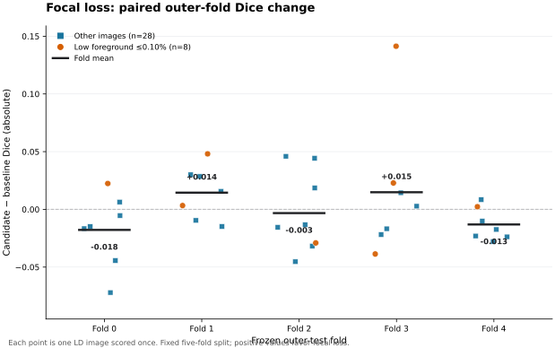
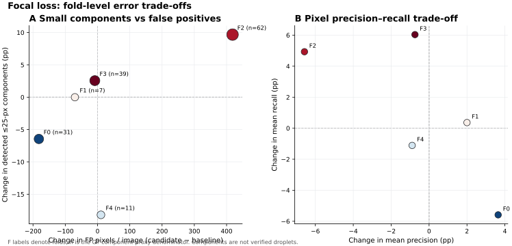

# LD 小脂滴漏检：focal BCE + soft-Dice 单因素五折实验

**结论（2026-10-14）：保留冻结的 LD baseline。** 五折各自的预注册、仅用内层验证集的门控均选择 baseline。focal 候选在八张低前景图上的召回有所提高，但总体 OOF Dice 未提高，远离标注的假阳性增加。现有全 36 张训练的生产模型、`fluo_label`、人工 TIFF 和标签均未改变。

## 问题与实验锁定

用户确认此前人工复核的八个小亮点为脂滴。这些点来自已经反复分析的开发数据，不能当作独立测试集，也没有完整的新人工轮廓。我们据此提出**假设**：将 baseline 的 BCE 项换成对难像素更敏感的对称 γ=2 focal BCE，可能减少小 LD 漏检；同时必须监测假阳性。该假设不是已证实机制。

[预注册协议](../../experiments/ld_focal_dice_protocol.md)在候选训练前锁定，SHA256 为 `c5a906123a9ce0f00630dc66801d1753992f3f024dfb53343236a96844312cef`；实现提交为 `63c5ed7`，已推送私有仓库。唯一的科学改变是损失中的 BCE→无类别权重、γ=2 的对称 focal BCE；soft-Dice 项保持原样。冻结的 36 张派生二值标签、分组五折、U-Net 结构、512×512 原像素裁块、p1–p99.8 归一化、0.60 前景中心采样、增强、Adam 1e-4、100 steps/epoch、最多 100 epochs、512 像素重叠窗口、checkpoint 选择及验证集阈值策略均不变。每折从随机初始权重训练一次，实际完成 28、85、74、77、65 epochs。

每折训练只读该折 train/inner-validation mask。五份 checkpoint/阈值选择锁先产生；随后同折 baseline 与候选只在 **固定阈值 0.50 的 inner-validation** 上做预注册门控；五份方法决策全部写入只增不改的 lock 后，才开始读取任一候选 outer-test mask。每张图只在所属外层折评分一次。外层结果不能修改门控或阈值。五份决策保存在 [`experiments/results/`](../../experiments/results/) 的 `ld_focal_gamma2_fold*_decision.lock.json`。

## 36 张图像的配对 OOF 结果

下表均使用各折**内层验证集选择的阈值**，是同一批 36 张已标注开发图像的描述性比较；“±”为逐图样本标准差。

| 指标 | 冻结 baseline | 原始 focal 候选 | 配对均值变化 |
| --- | ---: | ---: | ---: |
| Dice | 0.763693 ± 0.106970 | 0.762659 ± 0.094865 | −0.001033 |
| IoU | 0.628273 ± 0.126390 | 0.625070 ± 0.117066 | −0.003203 |
| Precision | 0.761894 ± 0.094908 | 0.755075 ± 0.102351 | −0.006819 |
| Recall | 0.782860 ± 0.159413 | 0.793243 ± 0.142819 | +0.010383 |

focal Dice 中位数为 **0.801183**，最小值 **0.504983**，最大值 **0.889707**；baseline 分别是 **0.798459 / 0.363636 / 0.885812**。36 张图中 16 张 Dice 改善、20 张下降。按外层折配对的平均 Dice 变化为 **−0.0178、+0.0144、−0.0033、+0.0149、−0.0131**（fold 0–4），方向不一致。

## 小 LD 与假阳性

外层 OOF 的 ≤25 像素、8 邻域连通域仅是**语义 mask 中的小区域代理指标**，不能视为已验证的逐滴 instance recall。按“至少一个预测像素相交”计，focal 检出 **100/150**，baseline **97/150**；按覆盖至少一半计，分别为 **96/150** 与 **93/150**。这是很小的 pooled 增量，并未满足任何一折预注册的验证集小区域门槛。

预先定义的低前景组（GT 前景 ≤0.10%，8 张）的平均 Dice 从 **0.730649** 升至 **0.752220**，平均 Recall 从 **0.806290** 升至 **0.875822**，但平均 Precision 从 **0.674689** 降至 **0.666925**。这组有 6/8 张 Dice 改善；其中 `ld_006.tif` 单张改善 **+0.1413**，去掉该张后其余七张平均变化仅 **+0.00446**。因此不能把该组均值增益解释为稳定解决小脂滴漏检。

全 36 张的 FP 像素 **21,917→23,516（+1,599）**，FN **26,314→26,149（−165）**；距 GT 超过 10 原像素的 FP **6,636→8,105（+1,469）**。低前景八张的 FP 也从 **2,811→3,080**，远距 FP **1,149→1,476**。这些结果支持“召回提升伴随额外背景误报”的观察；尚不能断言具体误报是亮背景、边界、伪影或标注不一致造成，需要对对应图像盲法复核。

## 预注册选择、风险与结论

验证门控的四项安全条件是：同折固定 0.50 平均 Dice 不低于 baseline−0.01；≤25 像素区域检出分数达到规定增量（有 ceiling 规则）；平均 Precision 不低于 baseline−0.03；且没有单张验证图 Dice 下降超过 0.10。**五折全部选择 baseline**。fold 1 的小区域检出为 **40/62→46/62（+0.09677）**，仍低于事先锁定的 **+0.10**，不能事后放宽。fold 0 和 fold 2 也未守住 Precision 条件。逐折 decision lock 与原始候选 OOF 都已保存；“全 baseline”的折选择研究策略恰好等于冻结 baseline，而不是一个新的全 36 张 focal 模型。

训练/验证过程没有 GPU 初始化错误、NaN 或缺失 checkpoint。外层折表现方向混合，不能宣称稳定泛化改善；训练曲线与 OOF 差异本身也不足以证明具体过拟合机制。更重要的限制是，这 36 张图已经多轮被用于提出假设，轮换的内层验证图还会在另一折成为 outer test；因此本轮 OOF 属于**探索性内部证据**，不是全新未触碰样本上的确认。已确认的八个漏检点同属这个开发池，未用于阈值、gate 或生产方法选择。人工抗锯齿 mask 的边界规则保持原样，连通域代理会受标注和相邻脂滴接触影响。

## 归档与算力

唯一一台 RunPod Secure Cloud **NVIDIA A40**，标价 **US$0.59/小时**，Python **3.11.17**、TensorFlow **2.21.0**、NumPy **2.4.6**、tifffile **2026.3.3**。TensorFlow 仅发现一张 GPU，GPU 矩阵运算预检通过。远端 runner 运行 **07:19:46–08:52:01 UTC**；553 次 `nvidia-smi` 记录的 GPU 利用率中位数 **92%**、均值 **72.6%**，观察到的显存最高 **43,963 MiB**，其中可能包含 TensorFlow allocator 预留，不能据此推出最低显存需求。

16 份折训练、决策、评估和最终元数据归档已逐一进行 SHA256 校验；本地 `local_verification.json` 状态为 `PASS`，五个 `.keras` checkpoint 可读，36 张 OOF 预测和指标齐全。大型归档只保存在 Git 忽略的 `runpod_results/ld_focal_20261014/`。Pod `8p4tkdl8ffda12` 在完成本地校验后已 **TERMINATE/DELETE**；RunPod 当前列出 0 Pods、0 Endpoints、0 Network Volumes、0 Clusters，故没有可见的持续计费资源。按 Pod 存活约 1.85 小时和标价估算，本次 GPU 加短暂容器磁盘约 **US$1.10**，低于 US$3 上限；账单 API 当时只入账 **US$0.529753**，仍有延迟，最终费用需待计费记录补齐后核对。

[逐图配对指标](paired_oof_per_image.csv)和[机器可读汇总](paired_oof_summary.json)不含 TIFF、预测图、模型权重或密钥。原始 TIFF、人工 mask、派生标签、冻结 baseline tag、Cetus 与已有 `fluo_label` 均未修改。

下一步优先获得**独立的新图像及完整人工 LD mask**，事先规定 ≤25 像素区域检出、远距 FP 和全图 Dice/Precision 的联合评估。仅凭这 36 张已反复查看的开发图，不应继续扫描 focal γ、阈值或损失权重。若新数据证实相同的漏检/误报机制，再以一个预注册因素设计训练集限定的局部背景/微小目标学习实验；本轮不启动新 GPU 训练，也不替换生产模型。
