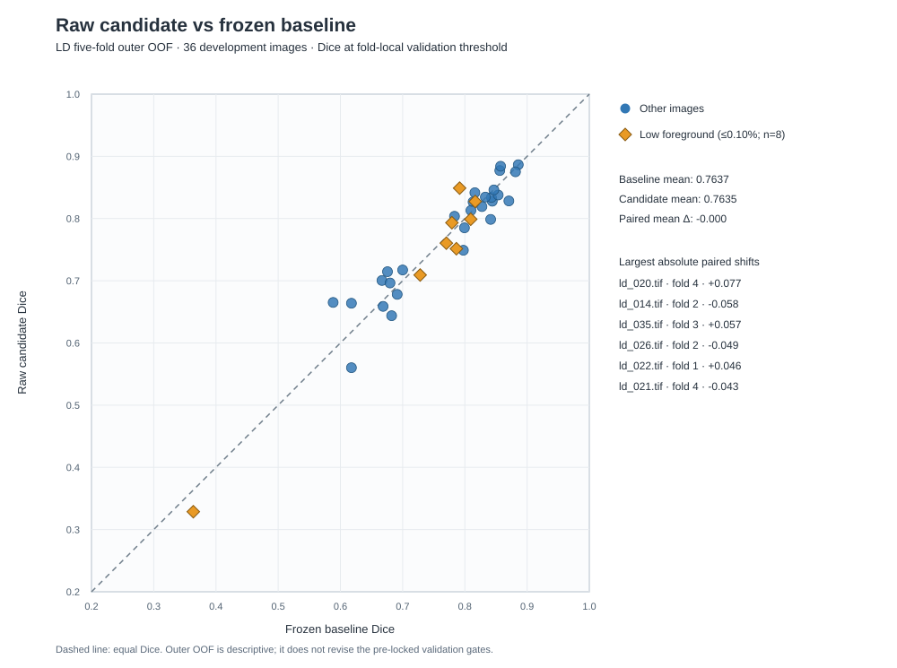
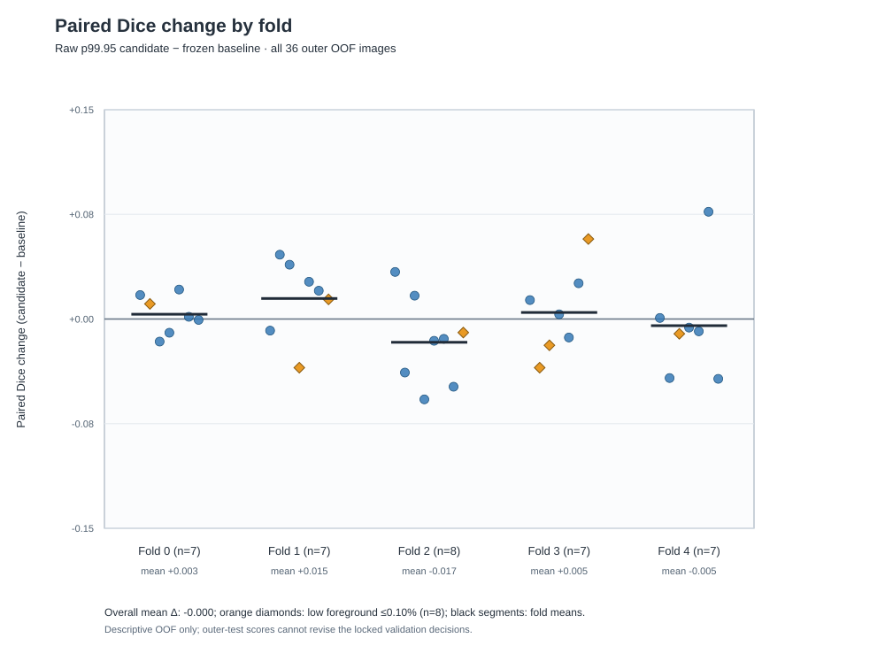

# LD 小脂滴漏检：高亮保留归一化五折实验

**结论（2026-10-14）：保留冻结 LD 基线，不替换现有生产模型或 `fluo_label`。** 仅把每图归一化上限从 p99.8 改为 p99.95，并在训练和推理中一致使用，没有带来可靠的整体或低前景 Dice 改善。内层验证的小型标注组件接触率上升，但在外层 OOF 没有重现；不能据此声称小脂滴检出改善。

## 研究问题和预注册设计

用户确认生产预测漏掉的六个亮点都是脂滴。现有记录只有中心坐标，没有完整人工轮廓；它们只用于提出假设，**不是独立测试集，也不能计算 Dice**。六处原始亮核均超过各图的 p99.8，旧归一化会裁剪其核心。旧模型上仅在推理时改用 p99.95，虽然六处中的四处产生响应，却使 36 张内层验证图的固定阈值 0.50 平均 Dice 降低约 0.0094、recall 降低约 0.0514。因此不能直接修改现有预测流程。

本轮按[事先固定的单因素协议](../../experiments/ld_highlight_normalization_protocol.md)从新权重训练五折：唯一科学改变是归一化上限 **p99.8 → p99.95**。36 对已标注图、派生二值标签、五折划分、2D U-Net、512 像素 patch、0.60 前景中心抽样、增强、BCE+soft-Dice、优化器、early stopping、阈值网格和 128 像素滑窗重叠保持不变。每折用本折训练/内层验证数据锁定 checkpoint、阈值和预注册门控；**全部五折决定锁定后**才做一次外层测试评价。外层结果没有回改决定。

## 冻结基线与五折结果

以下为 36 张图的 OOF **逐图宏平均**；`±` 是样本标准差。原始候选指五折全部使用新 p99.95 模型；门控组合只在验证门控通过的折用候选，在其他折用冻结基线。组合是折级研究策略，**不是**一个已训练的 all-36 生产模型。

| 指标 | 冻结 p99.8 基线 | 原始 p99.95 候选 | 验证门控组合 |
| --- | ---: | ---: | ---: |
| Dice | 0.763693 ± 0.106970 | 0.763508 ± 0.109167 | 0.764357 ± 0.108495 |
| IoU | 0.628273 | 0.628260 | 0.629260 |
| Precision | 0.761894 | 0.759035 | 0.772242 |
| Recall | 0.782860 | 0.785976 | 0.771973 |
| 最差单图 Dice | 0.363636 | 0.328767 | 0.328767 |
| 低前景 Dice（真值≤0.10%，8 张） | 0.730649 | 0.727321 | 0.731131 |
| 低前景 Precision | 0.674689 | 0.666364 | 0.677672 |

原始候选相对基线的逐图配对 Dice 均差 **−0.000184**，17/36 图改善、19/36 变差。各外层折的均差依次是 **+0.003439、+0.014713、−0.016693、+0.004706、−0.004729**，方向不一致。低前景八图的配对 Dice **−0.003328**、precision **−0.008325**；三张改善、五张变差。最差图 `ld_006.tif` 从 0.363636 降至 0.328767。

验证门控选中候选的折为 **0、3、4**；折 1 因同折验证 precision 降幅超过容限而保留基线；折 2 的 Dice、precision 与最差单图 Dice 条件均失败。门控组合的总体 Dice 仅比基线高 **0.000664**，10 图改善、11 图变差、15 图不变；最差单图变差，平均 recall 从 0.782860 降至 0.771973。不能称为稳健进步。

## 小组件、FP/FN 和漏检解释

必须区分两种不同的组件分析，二者使用**不同图像集和阈值**，不能合并解释：

- **内层验证、固定阈值 0.50、用于预注册门控：** 真值 ≤25 像素八连通组件的任意重叠为基线 **95/150**、原始候选 **115/150**、门控组合 **101/150**。这是已锁定的训练阶段证据。
- **外层 OOF、各折验证选定阈值、仅事后描述：** 同一定义的任意重叠为基线 **97/150**、原始候选 **96/150**。内层验证的增加没有在外层重现。固定 0.50 的外层辅助比较为 **98/150 对 98/150**。一个语义 mask 组件不一定对应一个真实脂滴，而且只要一个预测像素碰到组件就算命中，不能称为实例级 recall。

在外层 OOF 的验证选定阈值下，原始候选相对基线：FP 像素 **21,917 → 22,730（+813）**，FN **26,314 → 26,178（−136）**。离最近真值像素 **>10 px** 的 FP 为 **6,636 → 6,127（−509）**，距真值 ≤10 px 的 FP 则 **15,281 → 16,603（+1,322）**。后者只是空间邻近，不足以直接证明“边界扩张”；需逐图复核边界、对象粘连及标签语义。低前景八图只有 **3 个**这种 ≤25 像素真值组件，且两模型都命中，不能用该子集判断小脂滴检测能力。[派生误差统计](error_metrics.json)记录定义及逐图结果。

六个已确认的外部亮点说明现有生产输出有真实漏检；p99.8 亮核裁剪是合理机制线索，却未被证明是唯一原因。本轮**没有**训练 p99.95 的 all-36 模型，也没有用新候选五折模型正式预测这六处。此前“4/6 有响应”仅属于旧模型的推理侧诊断，不能当成本轮候选的外部成绩。

## 可信度、保存与决定

16 份训练、门控、外层评价和最终元数据归档均通过 SHA256 下载校验。本地复核还检查了 5 个 Keras checkpoint、有限的训练历史、五折锁文件、36 个唯一 OOF 样本以及 1200×1200 TIFF 的像素指标。可复核的小型文件是[汇总与锁定哈希](paired_oof_summary.json)、[36 张逐图配对指标](paired_oof_per_image.csv)及[派生误差统计](error_metrics.json)；TIFF、mask、checkpoint、日志和 734 MB 压缩归档只存在于 Git 忽略的本地 `runpod_results/ld_highlight_20261014/`。

单张 Secure Cloud NVIDIA A40 的运行环境是 Python 3.11、TensorFlow 2.21.0、NumPy 2.4.6、tifffile 2026.3.3。五折 runner 运行约 **1 小时 35 分钟**；569 次 GPU 采样的利用率中位数 **92%**，`nvidia-smi` 最大已用显存 **44,244 MiB**（包含 TensorFlow allocator 预留，**不是**模型真实最低显存需求）。Pod 已删除；RunPod 读取到的 Pods、Endpoints 和 Network Volumes 均为空，当前没有这些资源的持续费用。创建时的 GPU 报价为 **US$0.59/小时**；按约 1 小时 50 分钟 Pod 生命周期估算，GPU 加临时磁盘费用约 **US$1.10**，低于本阶段 US$3 上限。RunPod 逐 Pod账单在删除后仍有延迟，最近一次读取只到账 **US$0.586682**（尚未覆盖完整生命周期），最终金额以到账记录为准。

这 36 张一直是已标注**开发池**，之前也用于其他 LD 方法研究；当前五折 OOF 不是整个研究循环的独立外部确认。五折内层验证轮换覆盖开发池；逐折外层隔离可以防止本折直接泄漏，却不能消除反复研究带来的选择偏倚。人工 Photoshop 灰度边缘的二值化语义和组件/实例差异也限制了解释。不能根据 `ld_006.tif` 或任何外层差图再调阈值、百分位或选择重训。

**最终决定：冻结 p99.8 LD 基线保持为当前生产模型；不覆盖 `fluo_label`，也不继续扫描相邻归一化百分位。** 下一步先请专家为若干独立、尚未参与开发的 organoid 图像绘制完整 LD mask，覆盖已确认小亮点及相似亮背景结构。预先固定大小分层的 Dice、precision/recall 和 FP 审计后，才可判定真实小脂滴漏检能否改善而不引入不可接受误报。
