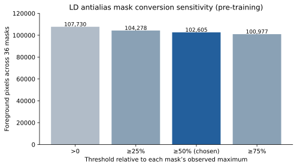

# LD manual-mask audit — 2026-10-12

This read-only audit preceded LD model training. The source dataset contains
36 exactly paired `ld_001.tif`–`ld_036.tif` image/mask files; all are
single-channel, one-page, 1200×1200 `uint16` TIFFs. The original files are
unchanged. No exact duplicate files were found.

The 33 Photoshop masks have multiple gray levels, while the three ImageJ
masks (`ld_003`, `ld_006`, `ld_021`) contain only 0/255. Photoshop
antialiasing was confirmed by the annotator; therefore the legacy binary
loader, which rejects masks with more than two levels, cannot train directly
on the source masks. A fixed uint16 threshold would mishandle the ImageJ
files. The [predeclared midpoint rule](../experiments/ld_antialias_label_protocol.md)
converts each file using half its observed maximum into a separate `uint8`
0/1 mask. It is fixed independently of model performance.

| Threshold relative to each mask maximum | Total retained pixels |
| --- | ---: |
| Greater than zero | 107,730 |
| At least 25% | 104,278 |
| At least 50% | 102,605 |
| At least 75% | 100,977 |

At 50%, 5,125 pixels are excluded compared with nonzero. Most lie on a
one- or two-pixel boundary fringe; eight connected regions containing only
12 pixels vanish completely. The zoomed overlay check did not establish
that these faint specks were complete droplets, so they remain an explicit
annotation-review uncertainty. Dense gray contour levels in some Photoshop
masks make a 90–95% cutoff unsuitable: it could discard genuine parts of
small annotated structures. `ld_017`, `ld_020`, and `ld_014` had the
largest relative boundary-fringe changes and were selected for local visual
QC; `ld_010`, `ld_013`, `ld_022`, `ld_023` were checked for lost microregions.

With the 50% rule, median per-image foreground is 0.1674%, with a minimum
of 0.00729% and maximum of 0.4846%. A provisional 8-connected analysis
found 1,851 components, with median area around 47 pixels; these are
**semantic-mask components**, not validated counts of biological droplets.
Median raw input intensity inside each mask exceeded outside-mask intensity
in all 36 files, consistent with image/label alignment, though this alone
does not prove exact registration. The uncommon appearance of `ld_017`
deserves visual QC during later error analysis, not a special-case threshold.

The source labels are a small, heterogeneous development pool. A particular
five-fold Dice score cannot validate the biological correctness of the
annotation standard. No model result was inspected to choose the label rule.
Raw input and cropped overlays remain in ignored local directories and are
not committed to Git.

## Input-only near-duplicate audit

Across the 630 image pairs, normalized-thumbnail raw correlation had median
0.675 and 99th percentile 0.919; some similarly centered organoids share
broad morphology. A pre-training graph based only on raw input intensities
linked six unusually similar pairs, yielding four conservative suspect
groups: `{001,003}`, `{006,007,034,035}`, `{030,032}`, `{033,036}`.
These groups stay within individual outer folds in the
[frozen baseline protocol](../experiments/ld_five_fold_baseline_protocol.md).
They do not establish shared specimen identity or Z order, and unrecognized
related images may still cross folds. The internal OOF estimate therefore
cannot be presented as proven organoid-independent generalization.
