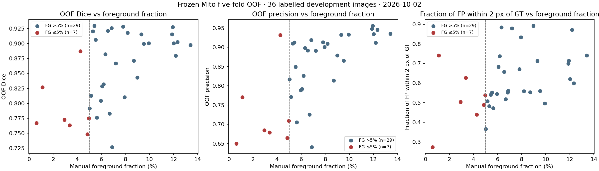
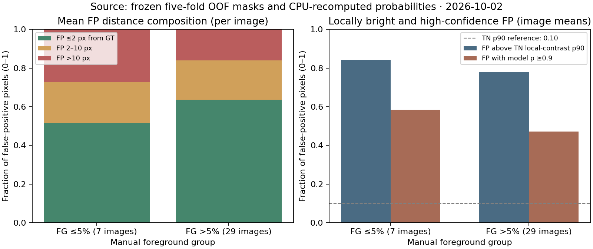

# Mito 冻结基线的五折 OOF 误差分析

**日期：**2026-10-02。36 对 TIFF/mask 均为已标注开发数据；未来未见的 organoid 图像尚未加入。本分析只读，不修改人工 mask、checkpoint、训练参数或 Cetus 作业，也未创建 GPU Pod。

## 核验与测量

逐图核对冻结 baseline 的 outer-fold 归属、1200×1200 输入/GT/预测及 Dice，36/36 与 [`oof_per_image.csv`](../baseline/mito_five_fold_20261001/oof_per_image.csv) 一致。距离以原像素计。局部对比度仅供诊断：逐图 1–99.8 百分位归一化后，减去 Gaussian σ=12 px 模糊图；每图固定种子采样最多 100,000 个真阴性（TN）像素作背景参照。所有组指标先逐图计算再平均，避免把像素误作独立样本。

本机 CPU 使用原 TensorFlow 2.21.0 和五个冻结 `.keras` checkpoint 重建 36 张完整概率图；按各折原 validation 选定阈值二值化，与归档的 **51,840,000** 个 OOF 像素仅有 **2 个**不一致，可能是 CPU/GPU 浮点差异。下列 FP/FN 统计仍以归档二值 mask 为准，概率只用于置信度诊断；没有基于 outer-test 标签重新选阈值。

复核脚本为 `code/mito_error_audit.py`、`code/mito_error_probabilities.py`、`code/mito_error_confidence.py` 和 `code/mito_error_figures.py`。统计／绘图本地环境为 NumPy 2.2.6、SciPy 1.16.2、Matplotlib 3.10.6、tifffile 2025.9.9；概率重算使用另一只读本地 TensorFlow 2.21.0 CPU 环境。脚本从命令行接收输入、标注、冻结 OOF 与输出目录，不在仓库写入原图或预测 TIFF。

| 以图像为单位的组均值 | 前景 ≤5%（7 张） | 前景 >5%（29 张） |
| --- | ---: | ---: |
| Dice | 0.7914 | 0.8695 |
| Precision / recall | 0.7272 / 0.8772 | 0.8661 / 0.8773 |
| 每图 FP / TP 像素 | 14,968 / 39,268 | 14,801 / 102,284 |
| 背景 FP 率 | 1.082% | 1.114% |
| FP 距 GT ≤2 px / >10 px | 51.6% / 27.3% | 63.7% / 16.0% |
| FP 属于与 GT 相交的预测连通域 | 67.7% | 76.8% |
| FP 强度高于同图 TN p90 | 95.2% | 78.2% |
| FP 局部对比度高于同图 TN p90 | 84.1% | 78.1% |
| FP 模型概率 ≥0.9 | 58.5% | 47.1% |
| FN 距 GT 内边缘 ≤2 px | 88.2% | 92.4% |

以**图像**重抽样 5,000 次的描述性 95% bootstrap 区间：低组减高组 Dice 为 [−0.1130, −0.0355]，precision 为 [−0.2012, −0.0588]，背景 FP 率为 [−0.00626, +0.00565]，FP 近边界比例为 [−0.2364, −0.0108]。样本不平衡且分组非随机；这些区间不构成因果检验或外部泛化保证。

## 目前能支持的解释

**主要可量化现象是基数效应加远距离亮结构误报。**两组每图 FP 都约 1.5 万，但低前景组 TP 只有另一组的约四成；相似的误报因此对其 precision/Dice 影响更大。低组另有较高的 FP 距 GT >10 px 比例（27.3% 对 16.0%），说明它不只是预测边界稍宽。其许多 FP 局部较亮且模型置信度很高；仅收缩边界或小幅提高全局阈值未必覆盖这种错误，且可能损害目前相近的 recall。这是**假设方向**，并未证明亮结构不是线粒体。

按 8 邻域、面积≥10 px 计算，GT 连通域中位面积的组均值均约 **159 px**；低组主要是连通域更少（163 vs 407），没有证据显示它们普遍更小。GT 组件被预测拆分的比例约 10.4% vs 9.8%；预测组件覆盖多个 GT 组件约 10.8% vs 5.9%。这些是二值像素连通性，**不是线粒体实例/生物学分支数**，极易受 1–2 px 边界影响，不能断言 fragmentation 或 merging 是主因。

原图 p99.8 强度跨图约 **459–28,447**，但现有逐图归一化已处理部分尺度变化。归一化后 4×4 网格背景中位数跨度，低/高组均值约 **0.209/0.232**；没有看到低前景组特有的更强背景梯度。局部亮误报仍存在，但目前不能把全局归一化失效作为定论。

## 人工复核图像与未确定因素

按前景占比分层，在每层取 Dice 最低和最高各两张，不只盯最差图。每张本地六面板含 input、GT、冻结预测、概率、全图 TP/FP/FN 叠图及 FP 最密集的 320×320 原像素裁剪（绿 TP、红 FP、青 FN）。这些**含原始生物图像的面板不进入 Git**，仅保存在 Git 忽略的 `outputs/mito_error_analysis_20261002/figures/`。

| 分层 | 较低 Dice | 较高 Dice |
| --- | --- | --- |
| 前景 ≤5% | `mask_009.tif` 0.748；`mask_004.tif` 0.763 | `mask_002.tif` 0.827；`mask_006.tif` 0.887 |
| 前景 >5% | `mask_010.tif` 0.727；`mask_020.tif` 0.776 | `mask_018.tif` 0.928；`mask_012.tif` 0.930 |

红色亮丝/亮斑究竟是其他结构、成像伪影还是漏标 Mito，需要独立熟悉标注规范的人复核；GT 模糊边界的一致性也尚未被第二标注者测量。**Annotation inconsistency 仍是假设，不能用这些图直接判定人工标签错误**，更不能因此修改 mask 或针对单图调参。

## 下一项单因素候选，仅设计未训练

选择**训练折内的亮背景 hard-negative patch-center sampling**，详见 [`mito_hard_negative_protocol.md`](../experiments/mito_hard_negative_protocol.md)。它保持原 0.60 前景中心采样，只把原 0.40 非前景分支的一半用于经 training mask 确认的远离 GT、高强度且高局部对比度背景中心；模型、loss、归一化、增强、patch、训练预算和推理均不变。与已失败的 0.60→0.35 比较，这检验的是**背景位置的选择**，不是正负比例扫描。

固定候选规则的本地可行性扫描发现每张图有 4,274–40,045 个合格背景中心，中位 13,026。它们在已看过的 OOF 中富集 FP，低/高前景组分别约 12.3/9.4 倍；这是后验描述，**不能当作候选效果或独立验证**。如专业复核发现大量“负样本”其实是漏标 Mito，增加其训练权重可能有害。下一次实验若获准也只能按原 frozen split、逐折 training 数据构建中心，以 validation 选模型；outer-test 不得参与。当前没有运行新训练或创建 Pod。
