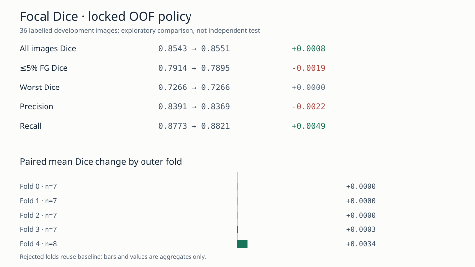

# Mito focal BCE + soft-Dice 五折单因素实验

**日期：**2026-10-08。**结论：reject；冻结 BCE+soft-Dice baseline 保持不变。** 本轮使用同一批 36 张已标注 2D 图像和冻结五折划分。它是反复研究过此数据池后的探索性比较，不是未来未见 organoid 图像的外部验证。原始 TIFF、人工 mask 与 frozen baseline tag 均未修改。

## 问题与方法

[系统误差与标注语义审计](mito_error_and_annotation_audit_20261008.md)发现，前景 ≤5% 的 7 张图与另外 29 张图每张平均 FP 数接近，但 TP 更少，precision 分别约 0.727 与 0.866；低前景图还含较高比例的远距亮 FP。已尝试的 0.60→0.35 前景采样、BCE+Tversky 和 bright-background hard-negative 采样均未稳定改善。因此本轮按[事前固定协议](../experiments/mito_focal_dice_protocol.md)，只把 BCE+soft-Dice 中的 BCE 项替换成**无 class-alpha、γ=2 的对称 focal BCE**。U-Net、0.60 前景中心采样、增强、归一化、512 patch、优化器、early stopping、验证阈值策略和 128 overlap 均维持 baseline。

五折模型先仅在各自 train/validation 图像上训练和选阈值；fold 0–4 分别训练 71、86、63、69、44 个 epoch。五折完成后，以各自 validation 图像和冻结 baseline 模型做同图配对，按协议一次性锁定选择。门控选中 fold 3、4，未选中 fold 0–2 的 OOF 行直接复用 baseline；**未对这三折的原始候选模型读取或评分 outer-test mask**。只有决策锁定后，才对入选折的 outer-test 图像预测和评分。下表的候选 OOF 是这个“validation 选择 + baseline 回退”策略，不是五折 raw focal 模型的分数。

五折最佳 full-image validation Dice 出现在 epoch 51、66、43、49、24，均在其后 20 个 epoch 由原 EarlyStopping 停止；训练历史未见 NaN/Inf。最后一个 epoch 的 validation Dice 低于各折最佳值约 0.0001–0.0058，显示部分折有验证表现回落，但训练 patch Dice 与整图 validation Dice 不可直接当同一分布比较，不能仅凭此判定过拟合程度。

| 外层 fold | 候选训练 epoch | validation Dice 均值差 | validation 低前景 Dice 差 | 入选 | 锁定策略 outer OOF Dice 均值差 |
| ---: | ---: | ---: | ---: | :---: | ---: |
| 0 | 71 | −0.000243 | −0.007447 | 否 | 0（回退） |
| 1 | 86 | +0.001920 | +0.002025 | 否 | 0（回退） |
| 2 | 63 | +0.000752 | +0.002929 | 否 | 0（回退） |
| 3 | 69 | +0.003489 | −0.002958 | 是 | +0.000311 |
| 4 | 44 | +0.003266 | −0.003159 | 是 | +0.003414 |

## 配对 OOF 结果

所有均值与样本标准差按 **36 张图**计算，不把像素当独立样本。完整 36 行见[锁定策略逐图结果](../experiments/results/mito_focal_dice_candidate_oof_summary.json)；[验证选择文件](../experiments/results/mito_focal_dice_candidate_decisions.json)与[只读复算汇总](../experiments/results/mito_focal_dice_postdecision_summary.json)可审计。

| 指标 | frozen baseline | focal 选定策略 | 配对均值变化 |
| --- | ---: | ---: | ---: |
| Dice | 0.854309 ± 0.062776 | 0.855128 ± 0.063985 | +0.000819 |
| IoU | 0.750677 | 0.752113 | +0.001437 |
| Precision | 0.839055 | 0.836855 | **−0.002200** |
| Recall | 0.877258 | 0.882125 | +0.004867 |
| 最低单图 Dice | 0.726555 | 0.726555 | 0 |

低前景（≤5%，7 图）Dice **0.791388→0.789528（−0.001860）**、precision **0.727167→0.722893（−0.004273）**、recall **0.877213→0.881509（+0.004295）**。其 FP 总像素 **104,776→111,394（+6,618）**，其中距现行 GT >10 原像素的 FP **27,542→30,310（+2,768）**。全部 36 图 FP **533,991→548,520（+14,529）**，远距 FP **108,432→111,661（+3,229）**；这些由下载的 1200×1200 预测和人工 mask 在决策锁定后逐图重算，Dice 与归档指标交叉核对。逐图 FP 数据见[小型表格](../experiments/results/mito_focal_dice_selected_oof_fp_per_image.csv)和[汇总](../experiments/results/mito_focal_dice_selected_oof_fp_summary.json)。

36 图中 10 张 Dice 上升、5 张下降、21 张不变；不变者大多因三折回退 baseline，不能算作 focal 的正面证据。两个入选折的 outer 均值略升，但总体增益不足 0.001、Dice 离散度上升、最差图不改善，且目标低前景组 Dice/precision 与远距 FP 同时变差。**本轮不晋升 focal 为 current best，也不围绕 γ 或 class-alpha 继续扫描。**

## 运行、校验与证据边界

唯一的 Runpod Secure Cloud NVIDIA A40 Pod `1u5f3be2vobzqn` 使用 Python 3.11.17、TensorFlow 2.21.0、NumPy 2.4.6、tifffile 2026.3.3、SciPy 1.16.2。`cuInit(0)=0`，TensorFlow 看到一张 physical/logical GPU，GPU 矩阵乘法成功。五折训练约 **97.9 分钟**；15 秒间隔 `nvidia-smi` 样本平均 GPU utilization **68.5%**，最高观察显存 **44,248 MiB**。后者包含 TensorFlow allocator 预留，不能当作模型最低显存需求。五折历史没有 NaN/Inf，五个 `.keras` ZIP 均通过检查；五折归档、最终决策归档及两份入选折预测归档均在本地 Git 忽略目录 `runpod_results/mito_focal_dice_20261008/` 经 SHA256 校验。

五折进程退出码均为 0；归档 stderr 中未发现 traceback、OOM 或 CUDA 初始化失败。只读 manifest 见[小型归档元数据](../experiments/results/mito_focal_dice_manifest.json)；checkpoint、预测 TIFF 和原始运行日志仍只保留在 Git 忽略目录。

Pod 在全部关键归档安全下载后已 **TERMINATE/DELETE**；Runpod 复核显示 `list_pods=[]`、`list_network_volumes=[]`、`list_endpoints=[]`，可见资源当前支出速率 **US$0/hour**。运行单价 US$0.49/hour，新增预算上限 US$5。**费用：**Runpod 账单 API 在 2026-10-08 01:05 UTC 已列账 **US$0.671175**，但末小时仍在滞后入账。最后一次 `get_pod` 显示累计运行 6,894 秒，随后数秒内删除；按计时和单价估算最终 GPU 与 Pod disk 合计约 **US$0.95–1.00**，需以结算后明细为准。

这一结果不证明 focal loss 一般无效。替换 BCE 为 focal 同时改变了 BCE 项相对 Dice 项的数值权重；本实验只能解释为**整个 loss 的单因素消融**。门控使用同一小验证集做候选选择，所见 validation 增益带有选择乐观性。36 张图的原 organoid/Z 来源无法恢复，跨折独立性未知；五折 map 原先依据全部 mask 的前景比例分层，且研究者已经查看过 baseline OOF 错误。因此即使将来出现小幅内部增益，也需要独立新标注图像才能支持外部泛化主张。

下一步最有信息量的工作是执行已准备的[盲法标注语义复核](../experiments/mito_annotation_semantics_review_protocol.md)：本地忽略目录 `outputs/mito_annotation_review_20261008/reviewer/` 包含 63 个匿名原像素裁剪和 8 张整图，由熟悉 Mito 染色与标注 SOP 的两位人员先独立判断图像，再看 GT 轮廓。**专家判断尚未完成**，不能把亮 FP 直接称为漏标。复核完成前，不继续投入 GPU 做 ResUNet、loss 参数网格或新的 sampling 比例搜索；冻结 baseline 保持当前最有支持的 pipeline。
