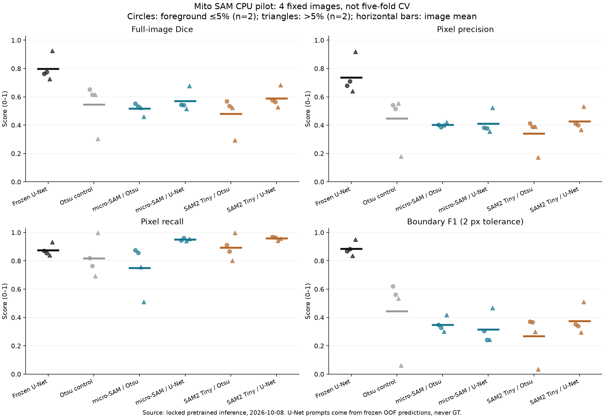

# Mito SAM 类模型本地可行性评估

日期：2026-10-08。结论：**当前不值得直接进入 SAM 五折微调；保留 frozen U-Net。** 两个预训练模型、两种自动提示路径在四张固定代表图上均退步。本结论限定于本次实现，不等于所有 SAM 或领域微调均无效。

## 基线、问题与文献

冻结36张五折 OOF baseline Dice 0.854309 ± 0.062776。sampling、Tversky、three-pool、overlap、hard-negative、focal 未建立可靠增益；低前景与FP仍是弱点。SAM 是否能识别细长线粒体、减少亮背景FP、改善边界，是本轮问题。

完整 [文献与官方代码核查](../experiments/mito_sam_research_notes.md) 涵盖 micro-SAM、MedSAM、SAM2、2026荧光线粒体SAM、WeakMitoSAM、ScSAM、Spatial-SAM。光学细胞/核、临床影像、电镜线粒体与本项目荧光语义mask不是同一任务。最新荧光方法更相关，但真实实例评估规模很小、指标不同，未定位可验证的专用公开权重，不能宣称复现。

## 设计与隔离

[运行前固定协议](../experiments/mito_sam_feasibility_protocol.md)。从已有OOF低/高前景、低/高Dice四个分层按固定hash选图：004、014、010、016；只有fold 0/3，不是五折结果。取样已使用既有OOF信息，明确属于探索性诊断，不能作为无偏泛化估计。

- micro-SAM LM ViT-B标准box predictor；没有运行完整AIS/APG。
- SAM2.1 Hiera Tiny静态图像 predictor。
- 输入自动Otsu连通域框：无需本项目训练；另设Otsu本身作控制。
- frozen U-Net OOF预测连通域框：全自动的两阶段refinement，**不是纯zero-shot**。
- 没有人工点击/框实测，也没有GT生成提示；不得将两者的潜在效果混入自动结果。
- 1200×1200按512原分辨率patch重叠处理，SAM内部标准编码尺度1024；概率拼回原坐标，阈值0.50。并非整图压缩到512。框最小面积10px、边缘4px等均预先固定。
- inference接口没有GT路径；全部预测完成后以SHA256锁定，再单独加载GT评分；不按结果调框、阈值或重跑。

## 同四张图的结果

不能把下表的baseline 0.7976与全36张0.8543混为一谈。所有值均为逐图宏平均。

| 方法 | Dice | IoU | Precision | Recall | 低前景 Dice (n=2) | Boundary F1 ±2px |
|---|---:|---:|---:|---:|---:|---:|
| Frozen U-Net | 0.7976 | 0.6705 | 0.7370 | 0.8741 | 0.7691 | 0.8843 |
| Otsu control | 0.5468 | 0.3881 | 0.4477 | 0.8182 | 0.6341 | 0.4448 |
| micro-SAM LM + Otsu boxes | 0.5170 | 0.3493 | 0.4025 | 0.7493 | 0.5417 | 0.3488 |
| micro-SAM LM + U-Net boxes | 0.5696 | 0.4010 | 0.4097 | 0.9500 | 0.5432 | 0.3145 |
| SAM2.1 Tiny + Otsu boxes | 0.4804 | 0.3225 | 0.3405 | 0.8941 | 0.5519 | 0.2680 |
| SAM2.1 Tiny + U-Net boxes | 0.5883 | 0.4193 | 0.4272 | 0.9582 | 0.5706 | 0.3745 |

四种SAM配置在**每一张**图上Dice都低于原U-Net。表现最高的SAM配置（仅描述结果，不升级为模型选择）为SAM2+U-Net框，平均ΔDice −0.2093，逐图下降0.1873–0.2417；micro-SAM+U-Net框ΔDice −0.2280。

SAM2+U-Net框的平均FP从24,933.75增至103,821.75像素（4.16倍），距GT>10px的FP从5,616.50增至13,744.25（2.45倍）。低前景precision由0.6942降至0.4047。Recall提高到0.9582，但不能抵消大幅precision损失。Boundary F1由0.8843降至0.3745。本次最差图Dice从baseline0.7266降至该方案0.5283。

## 可视化与解释的证据等级

四张整图、统一输入驱动裁剪、GT、所有预测及FP/FN叠图保存在本地忽略目录 `outputs/sam_feasibility_20261008/pilot/panels/`，不把生物图像推送Git。红FP、蓝FN、绿TP；裁剪由输入Otsu位置决定，不按误差挑裁剪。

观察004：SAM将部分细环/分支附近填成实心块，红色FP明显沿结构外扩和内部填充。观察016：亮弥散背景让Otsu把大片区域连起来，SAM2/Otsu继承了这个错误；用U-Net框仍出现结构增粗。micro-SAM/Otsu还有局部块状/patch边界伪影。

**有证据的结论：**本轮自动框→mask过程没有保留现有人工mask的细结构语义，且proposal质量会传递到结果。**尚待验证的hypothesis：**细胞/核预训练的对象完整性偏好、实例框歧义、编码尺度与patch拼接共同促成了填充/增粗。不能把低分唯一归因于模型架构，也不能根据SAM填得更满就判断人工标注错误。没有做实例匹配或骨架拓扑量化，因此不报告fragmentation/merging的定量结论。

## 资源、可复现性和技术问题

仅本机8 GiB RAM、arm64、CPU四线程，独立Python3.13.1/PyTorch2.10.0环境；未修改项目TensorFlow环境。没有Runpod、GPU训练、Cetus操作；新增云费用 **US$0**。

SAM2两种提示共享embedding总耗时29–53秒/图，micro-SAM77–129秒/图；这是CPU推理而非训练时间，不包含下载、也不包含预先存在的U-Net推理成本。整体最高进程RSS约2.77GiB，不是显存需求。不能据此可靠估计五折微调时间/成本。

权重下载中断导致一次不完整checkpoint加载失败；从断点完成下载并核对官方xxh128后只续跑尚未完成的micro-SAM，不重复SAM2、不读取GT后改参数。baseline预测路径在初始加载阶段更正为实际 `predictions/validation`，该目录此处保存的是validation-selected threshold下的outer-test预测。详细日志仅本地保存。

已验证：四张baseline评分精确复现冻结CSV；输入SHA不变；所有预测同尺寸、二值、概率有限；五个单元测试通过。小型 [逐图指标与manifest](../experiments/results/mito_sam_feasibility_20261008/) 保存模型SHA、版本、时间和提示数量。原36对TIFF与baseline/tag均不修改。

## 决策与下一步

**Reject** 本轮四种自动SAM推理配置；**keep** frozen U-Net。没有明确优势，故不启动GPU、不安排昂贵五折SAM微调或模型尺寸搜索。

最值得做的下一步是完成已有盲法annotation/SOP复核，确定细线、环内部、弥散亮背景的目标语义，再决定是否需要边界策略；这比继续更换SAM权重更有信息量。SAM可以另作为交互标注辅助候选，但应由人员只看输入提供prompts，记录人工时间、纠错次数和盲法语义一致性，独立于自动分割benchmark。

若未来拿到可验证的荧光线粒体专用checkpoint与像素尺寸标定，才值得做一次预注册、无需训练的本地验证。若届时确有优势，再设计五折：每折训练数据生成训练prompts/拟合统计，inner validation决定checkpoint/阈值，outer-test仅最终评分，自动prompts不得来自GT；保留相同split，并明确36张反复开发带来的selection bias，最终需要新数据确认。当前不因这四张OOF结果调整现有训练模型。
