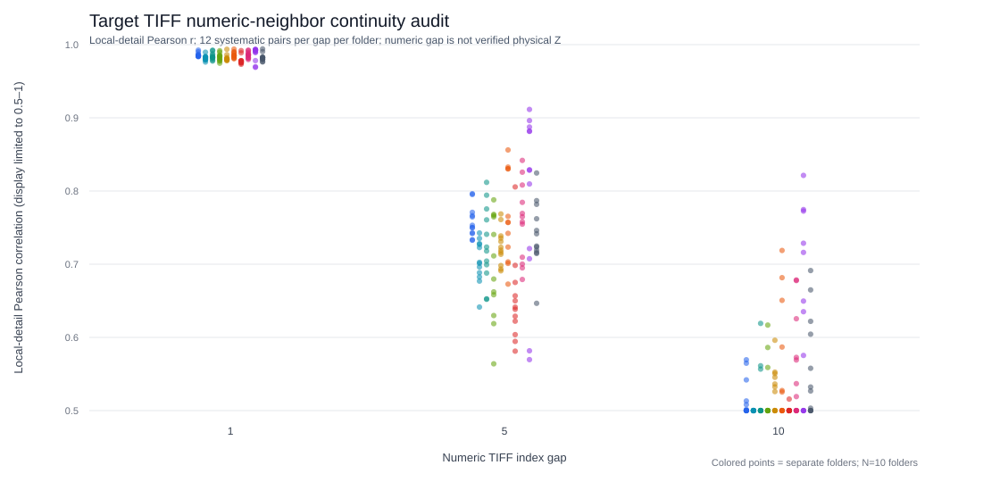
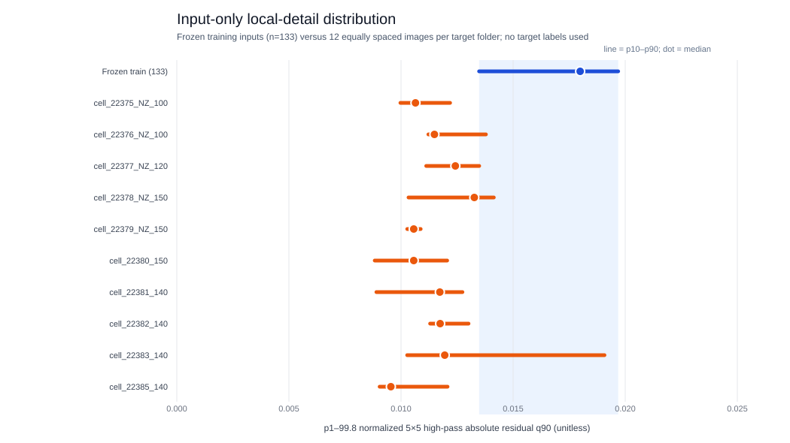
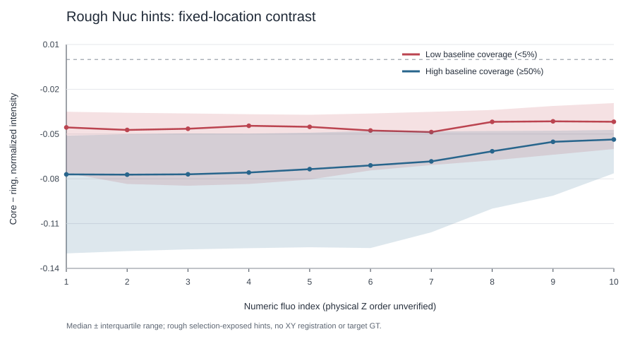

# Nuc：连续目标切片、来源混杂与 2.5D 决策（2026-10-16）

**结论：2.5D U-Net 在目标数据上技术上可行，但目前不具备可信的监督训练与模型选择条件。** 用户确认 `organoid_data` 每个 `cell_*` 文件夹是一枚独立类器官的连续切片；只读图像检查与此相容。瓶颈在于 167 张 `label_ref/Nuc` 人工标注图的原始类器官、视野与 Z 对应关系丢失，且编号中混入不同导出批次。不能把 `nuc_001…167` 直接当作一个 Z-stack。现有 2D 内部验证图与训练图高度近重复；真实目标的局部图像细节又系统性较弱。没有完整的独立目标 mask，任何新模型的目标 Dice 均不可计算。

## 数据来源核查

现有 **10 个**目标 `fluo` 文件夹共 **1,330 张** TIFF，各有连续的 100、100、120、150、150、150、140、140、140、140 个编号。全部是单页 1200×1200 `uint16`。用户给出的“每文件夹一个独立类器官、图像为连续切片”是本次分析的来源说明；除标准 TIFF 标签外，`ImageDescription` 仅含形状，`Software` 为 `tifffile.py`，**没有物理 Z 间距、方向或原采集 ID**。每文件夹系统抽取 12 对相邻编号图像：合计 120 对在 300×300 全视野面积均值缩略图上的相关系数中位数 **0.9980**，去除低频背景后的细节相关系数中位数 **0.9830**；编号差 5 与 10 时细节相关分别降至 **0.7295**、**0.4787**。跨不同文件夹采样的细节相关最高为 **0.401**，与独立场景的来源说明相容，但不是生物身份验证。另在各文件夹抽样共 30 对完整 1200px 相邻图做梯度相位相关，均未检出整像素 XY 位移；亚像素配准和全部切片尚未检验。该结果支持按文件夹准备邻层输入，却不能独立证明物理 Z 间距或每对切片的完美配准。[只读脚本](../code/nuc_target_stack_audit.py)与[聚合统计](assets/nuc_target_stack_audit_20261016.json)保留方法及每文件夹结果。

标注池的情况不同。[上一轮审计](nuc_provenance_and_error_audit_20261016.md)发现 167 张中 **148 张**在相似度 0.99 图上形成同一大连通分量，现有 34 张验证图中 **32 张**与某训练输入的相关性至少 0.99。进一步检查发现，该 148 张**恰好等于** 2025 年 11 月文件导出时间批次；另外有 2025 年 10 月的 10 张、2026 年 5 月的 9 张。多个不同批次文件被插在数字序列中。例如 `nuc_009` 与 `nuc_011` 的相关性约 **0.9991**，但中间的 `nuc_010` 与两边均仅约 **0.396**；`nuc_017/025/038/066/074/101/128` 也出现类似中断。时间戳仅说明文件导出／复制历史，**不是采集时间，也不能用来认定 148 张来自一个类器官**。然而这种整批高度近重复加插入图的事实足以否定“编号连续即可靠 Z 邻层”。[详细来源复核](nuc_provenance_followup_20261016.md)和[聚合图](assets/nuc_source_batch_followup_20261016.svg)记录了证据。

现有 Nuc 输入与 1,330 张目标 `fluo` 没有完全相同的 SHA256。额外尝试了低分辨率的旋转／镜像比对和对最相近候选的位移校正，最高相关性约 **0.949**，没有可据以建立 Nuc 标签→目标切片映射的匹配。两张 Nuc 输入与 LD 输入精确相同，只能证明两个标注池存在交叉，仍不能给出来源类器官和 Z 索引。粗相似度筛查也不能排除未知的复杂重采样或缺失的原采集文件。

后续只读查找覆盖本机 Desktop、Downloads、Documents 中常见的显微镜原始栈格式及相关命名清单，并复核 Git 历史；仍未找到逐张标注图的采集／导出映射。这个检索不包括 Cetus、外置盘、云端或其他命名的归档，不能据此断言原始记录不存在。把冻结验证按输入文件的修改月份重分组后，2025 年 10 月、11 月、2026 年 5 月分别只有 **1、32、1** 张验证图；在固定阈值 0.50 下，有核图 Dice 均值分别为 **0.9488、0.9584、0.9045**。前后两个批次各只有一张验证图，三个批次都同时出现在训练与验证里；这只能提示原验证无法量化跨来源泛化，不能据此认定五月批次成像更难。[完整复核及限制](nuc_export_cohort_validation_20261016.md)。

## 为什么当前 2D 模型会漏核：证据与未证实部分

原始 Nuc 2D U-Net 在原 133/34 同批次划分上的有核验证图 Dice 约 **0.956**；这个划分不是按来源独立的泛化试验。[对象级错误分析](nuc_provenance_and_error_audit_20261016.md)在已标注验证图上发现，面积至少 100px 的 1,175 个真值核中有 **22 个**预测覆盖不足 10%。这些区域面积中位数 **2,042px**，充分覆盖区域约 **5,800px**；暗核相对于亮环的对比更弱，预测概率中位数仅 **0.055**。同一批图还有背景碎片的假阳性，确认无核的 `nuc_005` 在冻结阈值 0.45 下有 **3,093** 个 FP 像素。因此降低阈值可能增加 FP，不能解释大多数极低概率漏检。

目标输入的差异不局限于前十张。沿用既定的逐图 p1–p99.8 归一化和 5×5 局部高通指标，133 张原训练图的逐图指标中位数为 **0.01799**；从 10 个目标文件夹各系统取 12 张、共 120 张的中位数为 **0.01129**，其中 **103/120** 低于训练图的第 10 百分位 **0.01348**。归一化后的第 90 百分位图像强度中位数也从 **0.582** 变为 **0.497**。这是**输入分布差异**的证据，未证明成像硬件或某一处理步骤是原因，也不能单凭它断定所有漏检均由低对比度引起。以前的局部对比度训练增强能改善人工合成扰动，却没有明显找回真实目标圈示核；固定局部背景标准化的输入诊断还放大了已确认无核图中的纹理。[分布图](assets/nuc_target_domain_audit_20261016.svg)仅作输入统计展示。

用户修正截图给出的红圈只是 **26 处粗略位置提示**，不是完整边界或负例集合。冻结原型在其中 11 处的粗略核心覆盖低于 5%，这些位置的预测概率中位数约 **0.012**；高覆盖提示约 **0.998**。只读查看 `fluo_001` 至 `fluo_010` 同一固定 XY 椭圆核芯—亮环对比：11 处低覆盖提示中，只有 **1 处**在 `fluo_002/003` 的对比比 `fluo_001` 明显增强超过 0.02 归一化强度单位。这个结果没有显示多数漏检可由“下一层更清楚”直接解释；它**不能否定**模型可能利用三维形态连续性，因为位置未配准、圈示不精确，且 `fluo_001` 本身位于对称 3/5 切片窗口的边缘。该分组已见过原型预测，只能是描述性分析，不能据此选择新模型。[固定位置图](assets/nuc_fixed_hint_context_20261016.svg)和[脚本](../code/nuc_fixed_hint_context_audit.py)保留具体定义。

**当前能确认的是原验证存在严重的来源依赖风险，目标输入统计也系统性不同；两者对漏检的因果贡献尚未分开测量。** 用户明确确认 `nuc_002`–`005` 真无核，而 `nuc_006` 的有核判断部分参考 `nuc_007`。这说明单图模型可能缺少部分人工作判断的信息，却不能证明全部标注图都按 Z 顺序排列，也不能说明 2.5D 一定胜过 2D。目标细节统计差异可能涉及成像、焦平面、样本构成或导出处理，不能仅凭目前数据归因。文献中的多切片比较在五个分割数据集里仅一个显示显著优于常规 2D，因此应把它当作待检验的对照，而非预设升级：[Vu 等](https://arxiv.org/abs/1912.09287)。跨实验核分割研究强调不同实验来源的泛化差异：[Caicedo 等](https://www.nature.com/articles/s41592-019-0612-7)；人工标注风格本身也可能不一致：[Cellpose 2.0](https://www.nature.com/articles/s41592-022-01663-4)。这些文献提供机制背景，不是本项目的新性能证据。

## 2.5D 与其他方法的决策

**优先路径：恢复标签来源，然后做严格配对比较。** 为每张已标注中心图建立由原采集文件或导出记录核实的 `organoid_id / field_id / z_index / z_spacing / channel / XY transform`，并确认相邻图及中心 mask 的坐标和语义。先把每个类器官的全部切片固定在同一训练、内层验证或外层测试组；有至少五个可信独立来源且正负例覆盖充分时才报告五折。原来已经审阅过的 167 张和目标红圈只可作探索性证据；可靠最终泛化仍需在方案锁定后使用此前未参与选择的独立来源完整真值。以**相同来源分组**重新训练 2D 对照和 `[z−1,z,z+1]→mask(z)` 的三输入通道 U-Net，只改变邻层输入；五通道作第二个预先声明的实验。现有 checkpoint 仅接受单通道，不能直接用于三通道推理；数据加载、同步增强与滑窗拼接也需要多通道适配。沿用 1200×1200 中心层坐标输出、重叠 patch，归一化边界从中心切片确定并用于邻层。首尾切片的复制／排除规则必须事先固定，且分别报告边界层表现。具体检查见[可行性协议](../experiments/nuc_25d_feasibility_protocol.md)。

**若无法恢复来源：目前不训练伪 2.5D。** 可以让现有 2D 输出结合切片连续性生成“人工复核优先级”或三维浏览辅助，但不得把未验证的跨层传播当作新真值或直接覆盖 `Nuc_label`。一次固定的局部背景处理或预训练核分割器可作为后续单因素对照；现有局部校正已提示真阴性 FP 风险，不能只看缺核恢复。针对未标注目标域的风格适配在文献中存在可行例子（如 [nucleAIzer](https://pmc.ncbi.nlm.nih.gov/articles/PMC8247631/)），但本项目仍需来源独立的真值确认其效果。如果用户保持“不增加任何新标注”的约束，且来源映射仍找不到，就无法可靠证明某个新监督模型比原型更能找回目标核。

本轮没有运行新模型、启动 GPU、修改原始 TIFF／mask／既有 `Nuc_label` 或触碰冻结基线；目标图和粗略圈示仅用于只读、不可作为模型选择分数的分析。
