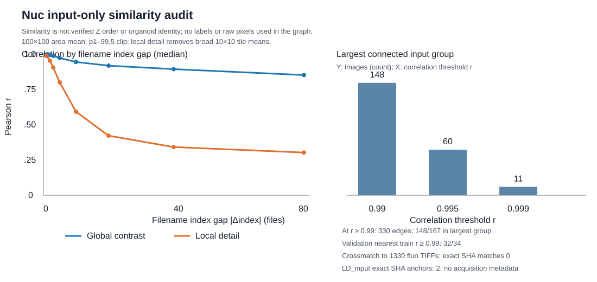
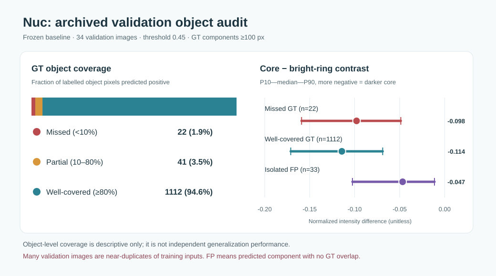

# Nuc 来源、近重复与漏检机制审计（2026-10-16）

**结论：目前不启动新训练，也不把 `nuc_###` 强行组成 2.5D 输入。** 数字文件名呈现明显的连续图像特征，但现有 TIFF 和项目文件没有可核验的类器官／视野／Z 映射；原 133/34 划分又严重混合相似视图。目标图像中的漏检伴随较弱的暗核—亮环信号，而相似的弱结构也会产生误检。前述两种光照／对比度候选均未可靠解决真实漏检。原 2D Nuc 原型及其输出保持不变。

## 范围与证据等级

本次只读检查 `label_ref/Nuc/Nuc_input` 与 `Nuc_output` 的 **167 对** 1200×1200 单页 TIFF、冻结的 **133 训练／34 内部验证** manifest、已归档的原型概率图，以及用户修正的 `fluo_001.tif` 粗略红圈。另以输入图像比对本地 `organoid_data/*/fluo` 的 **1,330 张** TIFF、LD 的 36 张和 Mito 的 36 张训练输入。没有运行新的分割模型、改写 mask、改变划分或利用红圈选择阈值。红圈不是精确边界，目标图没有完整人工真值，因此下文不报告目标 Dice 或核召回率。

现有原型以固定 0.50 阈值在 33 张有核内部验证图上的平均 Dice 为 **0.956452**；所选部署阈值为 **0.45**。另有一个确认无核的验证图 `nuc_005.tif`。照明扰动候选在同批次内部的 Dice 提高约 0.00143，但目标漏检仍在；局部对比度增强候选提高约 0.00084，33 张中 17 张改善、16 张下降，在合成扰动上提高却未明显找回目标红圈结构，并令无核验证图的 FP 从 2,744 升至 5,821（共同阈值 0.50）。这些都不是独立来源的外部评估。详见[原型](nuc_internal_prototype_v1.md)、[照明实验](nuc_spatial_illumination_20261016.md)与[局部对比度实验](nuc_low_local_contrast_20261016.md)。

## 来源与近重复：有顺序迹象，没有可靠 Z 标识

167 张 Nuc 输入和 167 张 mask 均为单页 TIFF；可见描述仅有 `{"shape": [1200, 1200]}` 与 `tifffile.py` 软件字段，没有采集文件、类器官、视野、通道或 Z 索引。用只读的 100×100 缩略图计算相似度后，相邻编号输入的全图相关系数中位数 **0.998429**，去除局部均值的细节相关系数中位数 **0.987554**；**149/167** 张输入的最近邻编号相差 1。非空人工 mask 两两的中位 IoU 随编号间隔 1／2／3／5／10 增加而约为 **0.872／0.775／0.687／0.538／0.315**。这与连续视图相容，但也可能是时间序列、重复采集或混合导出，不能证明它们是等间隔 Z 层。部分编号处相关性突然中断；没有依据可把中断点当作类器官边界。

在此新缩略图定义下，相关系数至少 0.99 的图像构成一个包含 **148/167** 张的连通分量；阈值提高到 0.995 后最大分量变为 60 张，分组对阈值敏感。**32/34** 张现有验证输入与某训练输入的全图相关系数至少 0.99，**31/34** 张有一个编号相邻的训练图。先前使用不同缩略图预处理的审计得出 29/34；两者不矛盾，但均表明现有内部验证不具备独立来源隔离。相关性分组只是依赖风险，不是生物来源标签。核分割跨实验基准也以完整新实验留出评估泛化，而非把相似视图随机拆开：[Caicedo 等，*Nature Methods* 2019](https://www.nature.com/articles/s41592-019-0612-7)。

全文件 SHA256 与缩略图交叉匹配显示：167 张 Nuc 输入与现有 **1,330** 张 `organoid_data/*/fluo` 图没有完全相同的文件，最佳全图相关系数最高仅 **0.926**；这排除了当前文件间的直接匹配，不能排除未发现的原始采集文件或经过复杂变换的副本。与 `label_ref/LD/LD_input` 有**两处精确交叉锚点**：`nuc_001.tif = ld_001.tif`、`nuc_159.tif = ld_036.tif`；与 Mito 输入没有完全相同文件。LD 文件同样缺失 Z／来源元数据，所以锚点只能证明两个标注池共享过这两张输入，不能推出完整序列或类器官编号。[可复现脚本](../code/nuc_provenance_audit.py)、[聚合 JSON](assets/nuc_provenance_summary.json)及[逐验证图近邻](assets/nuc_validation_nearest_train.csv)只包含统计量和文件名，没有原始像素。

## 有标签的错误与真实目标提示

在原型所选阈值 **0.45** 下，对 34 张归档验证图中面积至少 100 像素的 **1,175 个**人工核连通区域，按 GT 像素被预测覆盖的比例分层：**22 个低于 10%**、**41 个在 10%–80%**、**1,112 个至少 80%**。漏检组面积中位数 **2,042 像素**，覆盖充分组为 **5,800 像素**；暗核减周围亮环的归一化强度差中位数分别为 **−0.098** 与 **−0.114**（越负表示核芯相对亮环越暗）。漏检组核区域预测概率中位数 **0.055**；覆盖充分组约为 1。这说明漏检常是模型没有识别为核，而不是仅差一点阈值。验证图之间近重复，连通区域也并非独立生物样本；这些是描述性分层，不是新泛化分数。

同一验证集中另有 **33 个**面积至少 100 像素、与任何 GT 不相交的预测 FP 连通区域；其暗核减亮环差的中位数 **−0.047**。确认无核的 `nuc_005.tif` 在所选 0.45 阈值下有 **3,093** 个 FP 像素。FP 统计不包括连在正确预测区域上的边缘扩张，因此不是全部 FP 的形态归因。

对 `fluo_001.tif` 中 **26 处粗略红圈提示**，原型预测有 11 处在粗略椭圆核芯内的覆盖不足 5%，14 处覆盖至少 50%；剩余一处在两者之间。低覆盖提示的核芯预测概率中位数 **0.0118**，较高覆盖提示为 **0.9985**；相应暗核减亮环差约 **−0.045** 与 **−0.077**。低覆盖处在这两项描述性指标上更接近弱信号，但**红圈非精确真值**，与验证集的 GT 连通区域不能合并计算召回率。已确认的训练集无核图中也可见弱暗椭圆；增加敏感度可能同时放大这些背景碎片。逐区域 JSON、概率图和三个原图裁剪示例保存在 Git 忽略目录 `runpod_results/nuc_deep_audit_20261016/`，不会上传生物图像。[聚合指标](assets/nuc_error_object_summary_20261016.json)和[绘图脚本](../code/nuc_error_object_figure.py)可在仓库查看。

现有人工语义也限制单图判读：项目负责人明确确认 `nuc_002`–`nuc_005` 的全黑 mask 表示无核，并说明 `nuc_006` 的有核判断部分参考了 `nuc_007`。`nuc_005` 与 `nuc_006` 原始输入高度相似，但局部可见度和人工判断不同；不能据此说 mask 错。独立 2D 模型没有人工参考的邻图信息，可能难以复现这种边界病例。这个例子也**不能反推所有 `nuc_###` 都按 Z 排序**。更多只读语义证据见[上一轮报告](nuc_low_local_contrast_20261016.md)。

## 一次固定的局部背景标准化诊断

只做**输入图统计**，没有在校正图上运行或训练分割模型。先使用既有逐图 p1–p99.8 归一化，再以训练集核长轴中位数对应的 **101 像素**反射边界局部方窗计算均值和标准差；标准差下限取**仅训练输入**估计的第 10 百分位 0.01172；固定变换为 `clip(0.5 + (I−局部均值)/(4·max(局部标准差, 下限)), 0, 1)`。没有搜索其他核宽、下限或增益，也没有根据目标红圈选参数。

以同一 5×5 方窗高通残差的第 90 百分位衡量输入局部细节时，133 张训练图与前 10 张无标签目标图的中位数从 **0.01799／0.00964** 变为 **0.04614／0.04771**。但三张确认无核的训练图也从 **0.01069** 升到 **0.06385**，比校正后的训练中位数更高，提示碎片和噪声同样可能被放大。这个统计量在校正前后**分别重新选择强度 0.15–0.85 的像素**，不保证比较的是同一批位置；因此只表明所定义的输入分布统计量靠近，不能说真实核细节已被恢复。该 5×5 指标与此前报告的高斯 σ=2 指标**不同，数值不能跨报告直接相减**。这项检查**没有证明分割质量改善**，也不足以启动训练。[聚合诊断 JSON](assets/nuc_local_background_summary_20261016.json)已保存；完整诊断脚本和逐图结果仅存本地忽略目录 `runpod_results/nuc_deep_audit_20261016/`。显微镜背景／照明校正本身是有机制依据的研究方向，但需单独评估是否保留真实结构：[BaSiC 原始研究](https://www.nature.com/articles/ncomms14836)。

## 假设、限制与下一步

目前证据最支持两个并存的难点：**目标输入局部对比／细节与开发数据不同**，以及**弱暗核与背景假阳性在单张图上可能重叠**。人工使用邻图判读的个例让“缺失 Z 上下文”值得研究，但其普遍性和收益尚未测量；它不是可以靠文件名补出的信息。原型内部 Dice 很高主要说明其同批次表现，不能替代来源独立的验证。局部对比度候选在人工合成压力测试上的优势不能证明真实目标改善。核较小可能增加难度，但目标粗略红圈与已标注核尺寸有重叠，单独用尺度解释不足。

已准备[条件性的 2.5D 可行性协议](../experiments/nuc_25d_feasibility_protocol.md)：先取得并核验原始采集／导出记录，把每个已标注中心 TIFF 的哈希可靠对应到类器官、视野、Z 层、间距、方向和邻层，且检查中心 mask 像素对齐及“仅标中心平面”的语义。此后才能在**验证过的独立类器官组**上做组间隔离；若要声称五折，需要至少五个真正独立且可用的组。首个模型比较应在**相同来源组划分**下使用 `[z−1,z,z+1]→mask(z)` 与原 2D 模型配对，之后才单独考察五张输入；整张输出仍是中心层的 1200×1200 mask。没有来源映射时，不应把 `nuc_005/006/007` 或所有连续编号直接当作 Z 窗口。多切片输入在其他任务中技术上可行，性能优势却并非普遍：[Guo 等，*eLife* 2020](https://pmc.ncbi.nlm.nih.gov/articles/PMC7431134/)、[Vu 等，多数据集比较](https://arxiv.org/abs/1912.09287)。

如果仍找不到采集记录，下一步只应维持独立 2D 路线：以这些已标注图进行训练集内的暗核／亮环和真阴性分层分析、固定研究方案；任何新的局部背景处理都需在可靠分组或独立来源真值可用后，单因素比较召回与无核图 FP。**这 167 张标签及当前目标红圈已被反复用于提出假设；即使以后能按来源重划它们，所得结果仍属于选择暴露后的探索性证据，不能冒充全新独立测试。**可信的最终跨来源性能需要事先锁定评估规则，并使用此前未参与模型／方案选择的独立来源真值。否则既无法可信地选择新模型，也不能宣称真实目标漏检已经被修复。当前**没有新 GPU 训练、没有费用、没有改变原始 TIFF／mask／冻结基线或既有 `Nuc_label`**。
