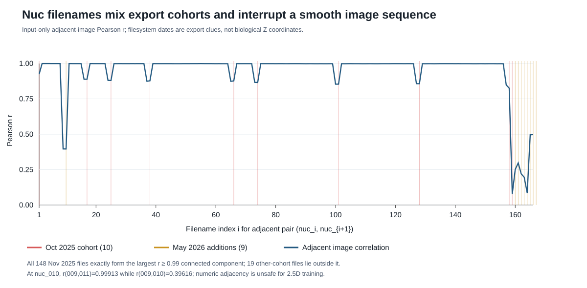

# Nuc 2.5D 来源追查补充：文件名并非可靠的连续 Z 轴

这是一项只读来源审计，补充[先前的 Nuc 来源与错误报告](nuc_provenance_and_error_audit_20261016.md)。检查了 167 张人工标注输入、36 张 LD 训练输入以及 10 个目标细胞文件夹中的 1,330 张 `fluo` TIFF。没有改动 TIFF、mask、既有模型或划分，也没有训练模型。本报告里的文件时间、图像相似度和精确文件匹配都是**线索**，都不是经过采集记录核验的 organoid ID 或 Z index。



## 新发现

167 张 `nuc_###.tif` 可以按文件系统修改时间分成三个批次：**2025 年 10 月 10 张、2025 年 11 月 148 张、2026 年 5 月 9 张**。使用此前固定的输入图像缩略图相关性定义，在阈值 `r ≥ 0.99` 下，最大连通分量的 **148 张恰好是全部 2025 年 11 月批次**；其余 19 张没有落入该分量。这不能说明 148 张属于同一个类器官，但证明了当前编号列表混合了与图像相似性强烈对应的不同文件批次，不能直接把所有相邻编号当成相邻 Z 层。

数个编号位置显示“插入式”不连续：前后两张高度相似，中间一张却明显不同。以下系数使用同一 100×100 输入缩略图和 p1–p99.5 裁剪计算；`前—后` 指跳过中间图像后的相关性。

最明显的 `nuc_010`，前—中／中—后／前—后 `r` 分别约为 **0.396／0.396／0.999**。同样三个系数，在 `nuc_017` 为 **0.888／0.889／0.996**，`nuc_025` 为 **0.881／0.880／0.996**，`nuc_074` 为 **0.867／0.866／0.996**，`nuc_128` 为 **0.857／0.857／0.994**。

`nuc_038/066/101` 也表现出类似前—后高相关、经中间图像降低的模式；`nuc_158/159` 与 `nuc_160`–`167` 所在尾段则更加复杂，不能用一个简单的“跳过异常文件”规则恢复完整序列。高相关性本身不证明某两张有连续的物理 Z 间隔；上述现象也不能断言中间图像一定来自别的类器官。但它足以否定“仅按 `nuc_###` 编号构造三或五通道训练样本”的安全性。

`nuc_001` 与 `ld_001`、`nuc_159` 与 `ld_036` 各有一次**完整文件 SHA256 相同**。两处 Nuc/LD 文件都具有 2025-10-09 15:40:17 的相同文件时间；同期各有 10 张 Nuc 和 10 张 LD 输入。另有几张在这两个标注池间呈高图像相似度，但没有逐文件精确相同。**这只说明标注池复用了部分输入，并不能推导有一个或多个原始类器官、Z 方向或切片序号。** TIFF 的标签仅报告尺寸、像素类型及 `tifffile.py` 软件等信息，没有采集 `DateTime`、类器官、视野或 Z 标签。文件创建/修改时间与分批导出或拷贝相容，**不是显微镜采集时间**；不同机器上的时间戳也可能被复制操作改变。

为排查“目标文件只是旋转／镜像／轻微平移后的已标注文件”，在 60×60 面积均值缩略图上逐一比较了 167×1,330 对图像的八种直角旋转/镜像方式。最佳全图 Pearson `r=0.9487`，没有一张已标注输入在此粗筛达到 `r≥0.99`。对得分最高的 20 个粗筛候选再容许最多 6 缩略图像素平移，最高约 `0.9491`。这**没有**找到可核验的坐标一一对应；它也不能排除未知的非线性处理、不同 Z 或尚未找到的原始采集文件。

在当前挂载的 Desktop Organoid 项目及本地代码仓库内，还未发现 `.czi`、`.nd2`、`.lif`、`.ome.tif` 等显微镜原始栈或采集／Z 清单；现有 manifest 是后续训练或预测生成的。这个文件搜索只覆盖当前可访问的项目，不表示学校或其他磁盘上不存在原始采集记录。

## 对 2.5D 方案的直接影响

目标文件夹内数百张 TIFF 提供了**候选邻层输入**，但目前没有可信映射能把 167 张人工 mask 对应到这些文件夹的某个中心层及其邻层。把目标 `fluo` 序列用于推理并不解决训练标签的来源问题；不能为了训练把尚未验证的 `nuc_###` 数字序列直接堆叠。现有随机 133/34 内部划分也把高度相似的 11 月批次拆到训练与验证，不能评估跨类器官泛化。即使将来证明这 148 张是某个真实连续栈，如果只有一个独立来源，仍无法仅靠它进行可信的按类器官分组验证。

当前最有价值的非训练步骤是找回**原始采集或导出清单**，逐张核对输入哈希、类器官/视野、通道、真实 Z 顺序与间距，以及训练 mask 所对应的中心切片。两处 LD 精确锚点可以帮助搜索原始档案，却不足以自动扩展出整套映射。若能核验多个独立来源，再按[预先写好的条件性 2.5D 协议](../experiments/nuc_25d_feasibility_protocol.md)，在来源整组隔离的相同划分上比较 2D 与 `[z−1,z,z+1]→mask(z)`，随后才考虑五张输入。当前没有启动新的 GPU 训练，也没有用已反复查看的目标图像调参。

复现聚合统计与图表：

```bash
python code/nuc_batch_provenance_followup.py \
  --nuc-input-dir ~/Desktop/Organoid/label_ref/Nuc/Nuc_input \
  --ld-input-dir ~/Desktop/Organoid/label_ref/LD/LD_input \
  --target-root ~/Desktop/Organoid/organoid_data \
  --output-dir reports/assets
```

脚本只读取 TIFF 与文件时间，输出[聚合 JSON](assets/nuc_source_batch_followup_20261016.json)和上图，不保存原始像素或图像缩略图。
